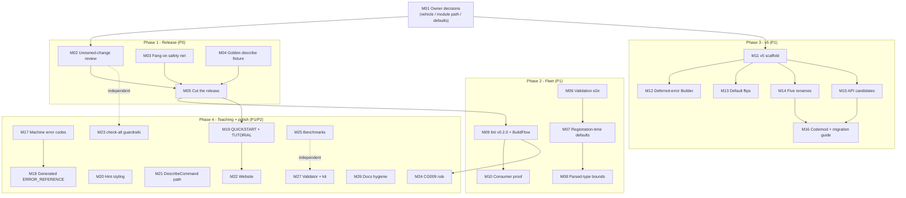

# Pareto Execution Plan — v5 Release Road

> **Date:** 2026-11-02 00:38 CET (via `date`)
> **Scope:** everything open in cmdguard right now, ranked by Pareto leverage.
> **Inputs read before ranking:** `TODO_LIST.md`, `ROADMAP.md`,
> `docs/planning/2026-11-01_v5-end-goal-paved-road.md`,
> `docs/status/2026-11-02_00-05_v5-end-goal-slices-and-validation-fix.md` (Next 50),
> `docs/status/2026-11-02_00-33_html-report-superb-pass.md`, `CHANGELOG.md`,
> `git tag` (latest core tag: **v4.1.0**; two days of work sit in `[Unreleased]`).
> **Customers:** (1) the LarsArtmann CLI fleet via BuildFlow + cmdguard-lint,
> (2) public OSS consumers, (3) AI agents driving the built binaries.
> **End goal (verbatim, from README):** make it impossible to NOT create superb
> CLI apps with near-zero bugs and fantastic UX, with minimum code.

---

## Errata (stale backlog findings, verified 2026-11-02)

Per pareto-planning Step 0, every candidate task was checked against reality:

| Finding                                                                                                    | Correction                                                                                                                                                                                                                                                                                                                                                                                                                                                                       |
| ---------------------------------------------------------------------------------------------------------- | -------------------------------------------------------------------------------------------------------------------------------------------------------------------------------------------------------------------------------------------------------------------------------------------------------------------------------------------------------------------------------------------------------------------------------------------------------------------------------- |
| `TODO_LIST.md` D1 says "8 tests" for describe                                                              | Stale. Reality: 7 describe + 6 `AddCommands` test functions in `describe_test.go` (fixed in this pass)                                                                                                                                                                                                                                                                                                                                                                           |
| `ROADMAP.md` §"Command-Level Audit Middleware" still says blocked on upstream ≥ v0.11.0                    | Stale. `TODO_LIST.md` F1 records it DONE 2026-10-09 (v0.11.0 tagged, `AuditMiddleware` shipped). Roadmap section rewritten as part of M26                                                                                                                                                                                                                                                                                                                                        |
| Test counts in the 00-05/00-11 status reports                                                              | Already corrected earlier this session (7+6, 8, 5)                                                                                                                                                                                                                                                                                                                                                                                                                               |
| `TODO_LIST.md` L5 marked DONE                                                                              | Correct but the _release_ it needs (lint/v0.2.0) is still open → M09                                                                                                                                                                                                                                                                                                                                                                                                             |
| S2 toolchain bump (go1.27.2)                                                                               | Still blocked on nixpkgs `go_1_27` ≥ 1.27.2; folded into M23 as a recheck trigger, not a standalone task                                                                                                                                                                                                                                                                                                                                                                         |
| NEW (found at push, 2026-11-02): GitHub reports 19 Dependabot vulnerabilities (6 high, 10 moderate, 3 low) | Website pnpm deps (undici <8.12.2 ×3, fast-uri <3.1.9, +14 more; matches BuildFlow `pnpm-audit`). S1's 2026-10-09 all-clear predates them. Folded into M02 scope: triage + `pnpm audit` clean before the release tag                                                                                                                                                                                                                                                             |
| M01 decisions (2026-11-02, owner)                                                                          | **Locked:** vehicle = v4.2.0 + migration note; module path = `/v5` with v5.0.0 (scaffold at M11); v5 defaults = strict + signals/graceful + batteries all flip (opt-outs stay). Also: unowned `.golangci.yml` loosening codified (lll stays out; issue caps 0 = infinite, intentional); website vulns fixed by bumping direct deps                                                                                                                                               |
| M02 resolution (2026-11-02)                                                                                | `.golangci.yml` daemon change codified with comment (lll redundant: golines formatter enforces max-len 120). go.mod/go.sum flap = gopls auto-tidy vs daemon commits; canonical `go mod tidy` under Go 1.27 adds sibling `replace` directives to sub-modules (harmless for consumers, ignored by proxy) + `/go.mod` graph hashes; verified by build+test of all 7 modules. Website: 19 Dependabot findings → `pnpm install` + `pnpm update undici zod` → audit clean, build green |

---

## Pareto Breakdown

### The 1% that delivers 51%

**The three owner decisions + tagging the release.**

Everything shipped in the last two days (describe contract, AddCommands,
hints, batteries, enforced validation) is sitting in `[Unreleased]` on HEAD.
Zero consumers benefit until it is tagged, and the tag is blocked on three
decisions only the owner can make (module path, release vehicle for the
behavior-changing validation fix, v5 defaults). One 30-minute decision session
plus one release pass converts ~51% of the total available value: the fleet
gets enforced correctness, hints, and the machine contract immediately.

1. Decide release vehicle for tag enforcement (v4.x + note / opt-in / v5).
2. Decide module path (`/v5` vs keep `/v4`).
3. Decide v5 defaults (strict, signals, batteries).
4. Apply decision 1: cut the release (v4.2.0 or v5.0.0 accordingly).

### The 4% that delivers 64%

The 1% **plus** the release safety net and fleet propagation:

5. Fang-on tests + golden describe fixture (make the release trustworthy).
6. Review/decide the unowned `.golangci.yml`/go.sum/website-deps changes
   (Next-50 #29 — must happen _before_ the tag, not after).
7. `lint/v0.2.0` + BuildFlow bump → CG007/CG008 + baseline + options reach
   every BuildFlow-covered repo (118 providers → whole fleet guarded).
8. Consumer proof: build + test erraudit and timesheets against the release.

At this point the shipped work is released, verified, guarded fleet-wide, and
proven on real consumers. That is ~64% of the end-goal value available today.

### The 20% that delivers 80%

The 4% **plus** the v5 shape and the teaching surface:

9. v5 scaffold (module path per decision 2) → unblocks every rename.
10. v5 default flips (strict/signals/batteries become the paved road).
11. The 5 `TODO(v5)` renames + additional candidates + unified middleware.
12. Deferred-error `Builder` (ends the constructor error ladder for good).
13. Rename codemod + `MIGRATION_v4_v5.md` (makes the break payable).
14. Machine error codes + generated `ERROR_REFERENCE.md` (kills drift).
15. Validation-semantics hardening (env/config e2e, registration-time
    defaults, Duration bounds).
16. QUICKSTART + TUTORIAL parity (batteries, describe, hints, runtime tags).

### The other 20% (to reach 100%)

The long tail that polishes but unlocks nothing: website parity, hint styling,
`DescribeCommand(path)`, CG009 dead-flag rule, benchmarks, check-all guardrail
additions (vet/govulncheck/coverage floor), HTML validator script + kit
upstream, docs hygiene, S2 toolchain bump (blocked), L6 golangci plugin layer,
fuzz corpus expansion, flightrecorder raw ideas, CONTRIBUTING refresh.

---

## Comprehensive Plan (medium granularity, 30–100 min each)

27 tasks, ~1,870 min total (~31 h). Sorted by importance → impact → effort →
customer value. P0 = release-blocking, P1 = v5 core + fleet, P2 = polish.

| #   | Task                                                                                                               | P  | Impact | Effort | Customer value                                    | Deps    |
| --- | ------------------------------------------------------------------------------------------------------------------ | -- | ------ | ------ | ------------------------------------------------- | ------- |
| M01 | Owner decision session (module path, release vehicle, v5 defaults); record in ROADMAP                              | P0 | 10/10  | 30m    | Unblocks 100% of downstream work                  | —       |
| M02 | Review + decide fate of unowned changes (`.golangci.yml` lll/max-issues, `go.sum`, website deps, `flake.lock`)     | P0 | 8/10   | 45m    | Trust in the repo state that gets tagged          | —       |
| M03 | Release safety net: fang-on tests (hints, batteries, opt-out, machine formats) + batteries×Draconian               | P0 | 8/10   | 90m    | Release trustworthiness; fang is the default path | —       |
| M04 | Golden describe fixture + byte-stability test (+ schema stability doc rule)                                        | P0 | 7/10   | 60m    | Agents can pin the JSON contract                  | —       |
| M05 | Cut the release: CHANGELOG version section, behavior-change note, tag, push, proxy verify, GitHub release          | P0 | 10/10  | 90m    | All shipped value reaches consumers               | M01–M04 |
| M06 | Validation semantics e2e: env-satisfies-required, config-file-does-not; document precedence                        | P1 | 7/10   | 45m    | Correctness contract is proven, not assumed       | —       |
| M07 | Validate tag defaults at registration; fail `NewCommand`/`AddCommand`                                              | P1 | 7/10   | 60m    | Bugs die at construction (P2 property)            | —       |
| M08 | Resolve parsed types (Duration/URL/Email/Port) before numeric bounds                                               | P1 | 6/10   | 45m    | Removes a wrong-error class                       | —       |
| M09 | Release `lint/v0.2.0` (CG007/CG008, baseline, options) + BuildFlow bump + fleet baseline                           | P1 | 9/10   | 90m    | Whole BuildFlow fleet gains guardrails            | M05     |
| M10 | Consumer proof: erraudit + timesheets build + full tests against the release                                       | P1 | 8/10   | 90m    | Real-world adoption evidence                      | M05     |
| M11 | v5 module scaffold per M01 decision (path, go.work, replaces, CI refs)                                             | P1 | 8/10   | 60m    | Unblocks M12–M16                                  | M01     |
| M12 | Deferred-error `Builder` + `NewApp` integration                                                                    | P1 | 7/10   | 90m    | Constructor error ladder ends (P4 property)       | M11     |
| M13 | v5 default flips (strict, signals+graceful, batteries; opt-outs stay)                                              | P1 | 9/10   | 60m    | "Default is the superb path" (P1 property)        | M11     |
| M14 | The 5 `TODO(v5)` renames (CommandMetadata, TypeCodec, HuhPrompter, remove SetConfig, RegisterInScope generic)      | P1 | 6/10   | 100m   | API honesty; clears 5 source markers              | M11     |
| M15 | Additional v5 candidates: Get→GetService, Package redesign, Middleware unification (+ telemetry migration)         | P1 | 6/10   | 100m   | One coherent API surface                          | M11     |
| M16 | Rename codemod + `MIGRATION_v4_v5.md`, dry-run on consumers                                                        | P1 | 7/10   | 90m    | The break becomes payable for consumers           | M14     |
| M17 | Stable machine error code per sentinel + `code` in JSON envelope                                                   | P1 | 7/10   | 60m    | Agents can switch on errors reliably              | —       |
| M18 | Generate `ERROR_REFERENCE.md` from sentinels + hints (drift-guarded)                                               | P1 | 6/10   | 90m    | Docs can never drift from code                    | M17     |
| M19 | QUICKSTART + TUTORIAL parity (batteries, describe, hints, runtime tag semantics); compile-check snippets           | P1 | 7/10   | 90m    | First-hour experience for humans and agents       | M05     |
| M20 | Hint line styling to match fang + hint table covers every exported sentinel                                        | P2 | 4/10   | 45m    | UX polish on the default error path               | M03     |
| M21 | `DescribeCommand(path)` subtree API + `--help=json` decision                                                       | P2 | 5/10   | 60m    | Agent ergonomics on large CLIs                    | M04     |
| M22 | Website docs + landing page parity; build + deploy                                                                 | P2 | 4/10   | 100m   | Public story catches up with code                 | M19     |
| M23 | check-all guardrails: go vet, govulncheck, coverage floor; S2 toolchain recheck                                    | P2 | 5/10   | 60m    | Regression net widens                             | —       |
| M24 | CG009 dead root-persistent flag lint rule + README table regen                                                     | P2 | 4/10   | 60m    | Dead-flag hygiene enforced                        | M09     |
| M25 | Benchmarks: Describe, AddCommands, validation (record vs pre-session baseline)                                     | P2 | 3/10   | 60m    | Proves the paved road is not slower               | —       |
| M26 | Docs hygiene: ROADMAP shipped marks, stale audit-middleware section, session-totals sync                           | P2 | 3/10   | 30m    | Backlog stops lying to future sessions            | —       |
| M27 | HTML validator script + html-report-kit upstream (validator, revision-marker rule, audit checklist, `.table-note`) | P2 | 2/10   | 60m    | Future reports are born verified                  | —       |

---

## Fine Breakdown (max 12 min per task, ALL TODOs)

Grouped by parent task; global order = execution order (importance first,
dependencies respected). `DoD` = definition of done.

| #    | Fine task                                                                                             | Parent | Est | DoD                                  |
| ---- | ----------------------------------------------------------------------------------------------------- | ------ | --- | ------------------------------------ |
| F001 | Draft 1-page decision memo: release vehicle, module path, v5 defaults (options + recommendation each) | M01    | 12m | Memo exists, options framed          |
| F002 | Record the three decisions in ROADMAP + plan errata                                                   | M01    | 10m | ROADMAP reflects decisions           |
| F003 | Update TODO_LIST D7 with chosen path                                                                  | M01    | 8m  | D7 row accurate                      |
| F004 | Diff `.golangci.yml` vs pre-change commit; list exact deltas                                          | M02    | 10m | Delta list written                   |
| F005 | Decide lll + max-issues fate; restore or codify with comment                                          | M02    | 12m | Decision applied, config intentional |
| F006 | Review `go.sum` deltas per module; annotate each hash origin                                          | M02    | 12m | No unexplained hashes                |
| F007 | Review website dep bumps + `flake.lock`; accept or pin back                                           | M02    | 11m | Decision recorded                    |
| F008 | Test: hint renders via fang default handler (fang on)                                                 | M03    | 12m | Test green under fang                |
| F009 | Test: batteries + fang on (version/doctor, styled path)                                               | M03    | 12m | Test green                           |
| F010 | Test: `WithoutErrorHints` + fang suppresses the line                                                  | M03    | 10m | Test green                           |
| F011 | Test: batteries + Draconian passes built-in commands                                                  | M03    | 12m | Test green                           |
| F012 | Test: machine formats suppress hints under fang                                                       | M03    | 10m | Test green                           |
| F013 | Run `-race` + lint over new tests; fix findings                                                       | M03    | 12m | Gate green                           |
| F014 | Build fixture CLI (nested commands, inherited flags, enum, env, count)                                | M04    | 12m | Fixture compiles                     |
| F015 | Golden JSON fixture file + byte-stability test                                                        | M04    | 12m | Test pins bytes                      |
| F016 | Opt-out + consumer-wins golden fixtures                                                               | M04    | 10m | Both paths pinned                    |
| F017 | Document schema stability rule in `describe.go` doc comment                                           | M04    | 8m  | Rule written                         |
| F018 | Wire golden tests into `go test`; verify `-race`                                                      | M04    | 10m | Gate green                           |
| F019 | Write CHANGELOG version section from `[Unreleased]`                                                   | M05    | 12m | Section complete                     |
| F020 | Write behavior-change note (validation + error text + exemptions)                                     | M05    | 12m | Note in CHANGELOG + release          |
| F021 | Check README badge/coverage/version freshness                                                         | M05    | 8m  | README current                       |
| F022 | Pre-flight: build + test + lint + tidy clean                                                          | M05    | 12m | check-all green                      |
| F023 | Annotated tag + push (per M01 vehicle: v4.2.0 or v5.0.0)                                              | M05    | 10m | Tag on remote                        |
| F024 | Proxy verification: scratch consumer `go get` + build                                                 | M05    | 12m | Proxy serves the tag                 |
| F025 | GitHub release with notes                                                                             | M05    | 10m | Release published                    |
| F026 | E2E test: env satisfies `required`                                                                    | M06    | 12m | Test green                           |
| F027 | E2E test: config-file value does not satisfy `required` (or flip + test)                              | M06    | 12m | Semantics pinned                     |
| F028 | Document config-source precedence in AGENTS gotcha                                                    | M06    | 10m | Gotcha updated                       |
| F029 | Re-run validation suite `-race`                                                                       | M06    | 6m  | Green                                |
| F030 | Implement default validation at flag registration                                                     | M07    | 12m | Code exists                          |
| F031 | Fail `NewCommand`/`AddCommand` on invalid defaults (typed error)                                      | M07    | 12m | Errors returned                      |
| F032 | Tests: invalid enum/regex/range defaults rejected at construction                                     | M07    | 12m | Tests green                          |
| F033 | CHANGELOG + AGENTS gotcha for construction-time defaults                                              | M07    | 12m | Docs updated                         |
| F034 | Reproduce Duration `min`/`max` misparse (test first)                                                  | M08    | 12m | Failing test captured                |
| F035 | Fix: resolve parsed types before numeric bounds                                                       | M08    | 12m | Test passes                          |
| F036 | Tests: Duration/URL/Email/Port bounds                                                                 | M08    | 12m | All green                            |
| F037 | lint CHANGELOG v0.2.0 section                                                                         | M09    | 12m | Section written                      |
| F038 | Bump lint module version + tidy                                                                       | M09    | 8m  | go.mod current                       |
| F039 | Tag `lint/v0.2.0` + push + proxy verify                                                               | M09    | 12m | Proxy serves tag                     |
| F040 | BuildFlow repo: `go get` bump + vendor + vendorHash                                                   | M09    | 12m | BuildFlow builds                     |
| F041 | Verify provider loads (fleet count, enable/disable options)                                           | M09    | 12m | Provider verified                    |
| F042 | Run cmdguard-lint on fleet corpus; commit reviewed baseline                                           | M09    | 12m | Baseline committed                   |
| F043 | erraudit: `go get` release, build                                                                     | M10    | 12m | Builds                               |
| F044 | erraudit: full test suite; fix breakages                                                              | M10    | 12m | Tests green                          |
| F045 | timesheets: `go get`, build                                                                           | M10    | 12m | Builds                               |
| F046 | timesheets: tests; fix breakages                                                                      | M10    | 12m | Tests green                          |
| F047 | Record adoption evidence in a status note                                                             | M10    | 8m  | Evidence written                     |
| F048 | Create v5 module path per decision (scaffold/copy, import rewrite)                                    | M11    | 12m | Module exists                        |
| F049 | go.work + replace directives + sub-module paths                                                       | M11    | 12m | Workspace green                      |
| F050 | Full build + test under new path                                                                      | M11    | 12m | Gate green                           |
| F051 | Update CI/docs references to the new path                                                             | M11    | 12m | No stale refs                        |
| F052 | Design `Builder` deferred-error API sketch                                                            | M12    | 12m | Sketch approved                      |
| F053 | Implement `Builder[T]` error collection                                                               | M12    | 12m | Code exists                          |
| F054 | `NewApp` integrates `Builder`                                                                         | M12    | 12m | Wired                                |
| F055 | Tests: deferred errors aggregated, none lost                                                          | M12    | 12m | Tests green                          |
| F056 | taskctl migration to `Builder` + LOC delta recorded                                                   | M12    | 12m | Bootstrap shrinks                    |
| F057 | Flip strict validation default (v5)                                                                   | M13    | 10m | Default on                           |
| F058 | Flip signals + graceful shutdown default (v5)                                                         | M13    | 10m | Default on                           |
| F059 | Batteries default; individual opt-outs remain                                                         | M13    | 12m | Opt-outs intact                      |
| F060 | Acceptance test asserts defaults with zero options                                                    | M13    | 12m | Test green                           |
| F061 | CHANGELOG v5 breaking-changes section                                                                 | M13    | 10m | Documented                           |
| F062 | Rename `CommandInfo` → `CommandMetadata`                                                              | M14    | 12m | Renamed, tests green                 |
| F063 | Rename `TypeHandler` → `TypeCodec`                                                                    | M14    | 12m | Renamed, tests green                 |
| F064 | Rename `PromptRunner` → `HuhPrompter` (prompts submodule)                                             | M14    | 12m | Renamed                              |
| F065 | Remove `SetConfig`                                                                                    | M14    | 12m | Gone, marker cleared                 |
| F066 | Replace `RegisterInScope` with generic variant                                                        | M14    | 12m | Replaced                             |
| F067 | `grep TODO(v5)` zero; update TODO_LIST/ROADMAP tables                                                 | M14    | 10m | Zero markers                         |
| F068 | Full workspace build + test + lint                                                                    | M14    | 12m | Gate green                           |
| F069 | Rename `Get[T]` → `GetService[T]`                                                                     | M15    | 12m | Renamed                              |
| F070 | Redesign `Package[T]`                                                                                 | M15    | 12m | New shape shipped                    |
| F071 | Unify `Middleware`/`ContextMiddleware`                                                                | M15    | 12m | One signature                        |
| F072 | Migrate telemetry submodule to unified middleware                                                     | M15    | 12m | Migrated                             |
| F073 | Check spinner/flightrecorder signatures                                                               | M15    | 10m | Consistent                           |
| F074 | Tests + docs for unified surface                                                                      | M15    | 12m | Docs current                         |
| F075 | Codemod tool for the renames (AST or gofmt -r)                                                        | M16    | 12m | Tool works                           |
| F076 | Test codemod on taskctl + cmdguard-lint                                                               | M16    | 12m | Clean conversions                    |
| F077 | Write `MIGRATION_v4_v5.md`                                                                            | M16    | 12m | Guide complete                       |
| F078 | Dry-run codemod on erraudit + timesheets copies                                                       | M16    | 12m | Dry-run clean                        |
| F079 | Polish migration guide examples                                                                       | M16    | 10m | Examples compile                     |
| F080 | Machine error code constants per sentinel                                                             | M17    | 12m | Codes defined                        |
| F081 | `code` field in JSON error envelope                                                                   | M17    | 12m | Envelope extended                    |
| F082 | Test: every sentinel has a stable code                                                                | M17    | 12m | Test green                           |
| F083 | Document the code table                                                                               | M17    | 12m | Table published                      |
| F084 | Generator: sentinels + hints → ERROR_REFERENCE                                                        | M18    | 12m | Generator works                      |
| F085 | Include cause, hint, exit code, anchor per sentinel                                                   | M18    | 12m | Full columns                         |
| F086 | Drift-guard test (regenerate → no diff)                                                               | M18    | 12m | Guard green                          |
| F087 | Wire generation into check-all or CI                                                                  | M18    | 12m | Automated                            |
| F088 | Replace hand-written sections; review diff                                                            | M18    | 10m | No duplication                       |
| F089 | QUICKSTART: NewApp + AddCommands + batteries intro                                                    | M19    | 12m | Section rewritten                    |
| F090 | QUICKSTART: describe + hints sections                                                                 | M19    | 12m | Sections added                       |
| F091 | TUTORIAL: runtime tag semantics                                                                       | M19    | 12m | Section rewritten                    |
| F092 | Compile-check every snippet (script or test)                                                          | M19    | 12m | Snippets compile                     |
| F093 | Cross-link from README                                                                                | M19    | 8m  | Linked                               |
| F094 | Style Hint line to match fang error styling                                                           | M20    | 12m | Styled                               |
| F095 | Extend hint table to every exported sentinel                                                          | M20    | 12m | Full coverage                        |
| F096 | Update coverage test + visual check                                                                   | M20    | 10m | Green + looks right                  |
| F097 | `DescribeCommand(path)` subtree API                                                                   | M21    | 12m | API exists                           |
| F098 | Tests incl. hidden commands                                                                           | M21    | 12m | Tests green                          |
| F099 | Decide `--help=json` alias; implement or document rejection                                           | M21    | 12m | Decision recorded                    |
| F100 | Agent usage docs for describe                                                                         | M21    | 10m | Docs added                           |
| F101 | Website pages: batteries, describe, hints                                                             | M22    | 12m | Pages drafted                        |
| F102 | Landing page refresh with new quick start                                                             | M22    | 12m | Landing current                      |
| F103 | Build website (pnpm); fix warnings                                                                    | M22    | 12m | Build green                          |
| F104 | Deploy per website-launch pattern                                                                     | M22    | 12m | Deployed                             |
| F105 | Add go vet + govulncheck to check-all; fix findings                                                   | M23    | 12m | Steps wired                          |
| F106 | Coverage floor (≥90% core) in check-all                                                               | M23    | 10m | Floor enforced                       |
| F107 | Recheck nixpkgs `go_1_27` ≥ 1.27.2; bump toolchain if ready                                           | M23    | 10m | Checked/decided                      |
| F108 | Run full check-all; document additions in AGENTS                                                      | M23    | 12m | Documented                           |
| F109 | CG009 dead root-persistent flag rule design                                                           | M24    | 12m | Design noted                         |
| F110 | Implement check + tests                                                                               | M24    | 12m | Rule ships                           |
| F111 | Regenerate README rule table                                                                          | M24    | 8m  | Table current                        |
| F112 | Dogfood on cmdguard + taskctl                                                                         | M24    | 10m | 0 FP                                 |
| F113 | Benchmark Describe (small + large trees)                                                              | M25    | 12m | Numbers recorded                     |
| F114 | Benchmark AddCommands batch                                                                           | M25    | 12m | Numbers recorded                     |
| F115 | Benchmark runtime validation                                                                          | M25    | 12m | Numbers recorded                     |
| F116 | Compare vs pre-session baseline; record                                                               | M25    | 10m | Delta written                        |
| F117 | Mark shipped workstreams in ROADMAP/TODO                                                              | M26    | 10m | Tables current                       |
| F118 | Fix stale ROADMAP audit-middleware section                                                            | M26    | 8m  | Section accurate                     |
| F119 | Sync session-totals numbers into MD companion                                                         | M26    | 8m  | Reports agree                        |
| F120 | Extract `scripts/validate-html-report.py`                                                             | M27    | 12m | Script exists                        |
| F121 | Upstream validator + revision-marker rule + audit checklist to kit                                    | M27    | 12m | PR/commit to crush-config            |
| F122 | Add `.table-note` component to kit templates                                                          | M27    | 8m  | Template updated                     |
| F123 | Render-verify both status HTML reports (browser)                                                      | M27    | 12m | Visually confirmed                   |

**Total: 123 fine tasks, ~22.4 h of estimated execution** (fits the 27 medium
tasks' 31 h with overhead for verification loops and gate runs).

---

## Execution Graph

Critical path: **M01 → M02 → M05 → M09 → M10** (decide, clean, release,
propagate, prove). Everything else parallelizes after M05 or M11.

---

## Verification gates (unchanged bar, per phase)

- After every medium task: `go build ./...`, affected tests `-race`,
  `golangci-lint` on touched packages.
- After each phase: `nix run .#check-all` (build + race tests across 7 modules
  - lint + format + tidy).
- Release (M05): go-release skill pre-flight; proxy verification with a
  scratch consumer; pkg.go.dev check.
- v5 (M11–M16): zero `TODO(v5)` markers; codemod dry-run clean on both
  consumer repos; migration guide examples compile.

## Explicit non-goals (do not verschlimmbessern)

- No rename for renaming's sake beyond the tracked list; v5 earns its major
  via defaults + contract, not churn.
- No `v4/internal/` split (12k LOC trigger not met), no koanf extraction, no
  `ConfigFile` branded type (YAGNI, per ROADMAP deferral rationale).
- No lint rule renumbering (CG001–CG008 IDs are load-bearing for
  suppressions; new rule is CG009).
- No changes to `lint` rule IDs or the `TODO(v5)` godox exclusion pattern.
- Flightrecorder raw ideas, plugin marketplace, config watching stay in
  ROADMAP raw ideas until a consumer asks.
