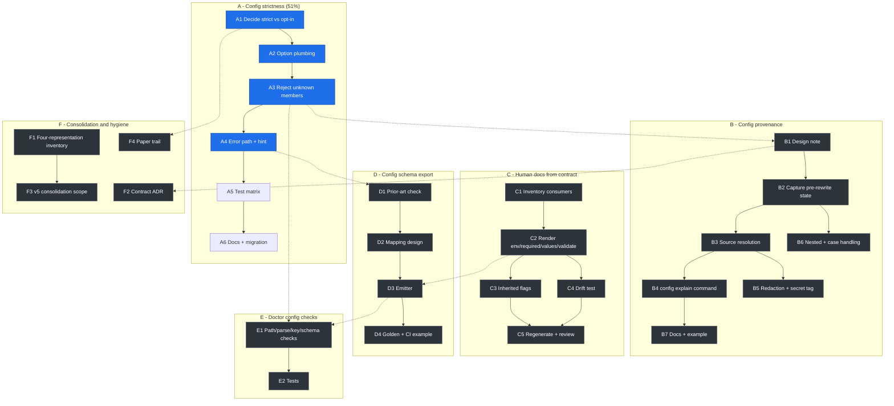

# Config Truth: Pareto Execution Plan

| Field          | Value                                                                                                                                    |
| -------------- | ---------------------------------------------------------------------------------------------------------------------------------------- |
| Date           | 2026-11-02 05:36 CET                                                                                                                     |
| Status         | Plan, not yet executed                                                                                                                   |
| Scope          | Make configuration fail loudly, observable, and self-documenting                                                                         |
| Excludes       | CUE adoption (rejected), v5 implementation, unrelated backlog                                                                            |
| Coarse plan    | 28 tasks, 30 to 100 minutes each                                                                                                         |
| Fine plan      | 149 tasks, 12 minutes maximum each                                                                                                       |
| Source reports | `docs/status/2026-11-02_04-52_cue-adoption-analysis-and-self-review.md`, `docs/status/2026-11-02_05-26_value-ranking-and-self-review.md` |

## 0. How to read this plan

The question that produced this plan was "what would actually add real value in
cmdguard". The answer, after assessing CUE and rejecting it, is a single theme:
**the configuration surface must be honest**. Today it can silently ignore a user's
typo, it cannot explain why a value won, and its human documentation is generated from
a different source than its machine documentation.

Every task below serves that theme. Nothing here adds a DSL or a dependency.

Two orderings are used deliberately:

- **Workstreams are ranked by leverage.** A is the shipping priority, F is hygiene.
- **Inside a workstream, dependency order beats score.** A decision must precede the
  code that implements it, even when the code scores higher.

Every coarse task has an explicit "done when" so a reviewer can reject it.

## 1. Grounded findings behind the plan

| #   | Finding                                                                                           | Evidence                                                                                                                                        |
| --- | ------------------------------------------------------------------------------------------------- | ----------------------------------------------------------------------------------------------------------------------------------------------- |
| F1  | Config files silently ignore unknown keys, so a typo leaves the app on defaults                   | `pkg/cmdguard/v4/koanf_loader.go:146` uses `json.Unmarshal` without `json.RejectUnknownMembers`; `encoding/json/v2.RejectUnknownMembers` exists |
| F2  | Validation is strictly field-local, so conditional requirements need hand-written code            | `pkg/cmdguard/v4/config.go:54`, `pkg/cmdguard/v4/flags_validate.go`                                                                             |
| F3  | Config precedence is four layers deep and cannot be explained                                     | flag > env > config > tag default, implemented by rewriting tag defaults at `pkg/cmdguard/v4/config_file.go:163`                                |
| F4  | The source of a value is computed then destroyed                                                  | `setFields` is consumed only by `updateTagDefaultsFromConfig`, which overwrites `Default`                                                       |
| F5  | Human docs are generated from pflag text, not from the machine contract                           | `pkg/cmdguard/v4/docgen.go:60` prints `cmd.LocalFlags().FlagUsages()`                                                                           |
| F6  | `Describe()` already carries env, required, values, validate, prompt, count                       | `pkg/cmdguard/v4/describe.go:75-90`                                                                                                             |
| F7  | There is no redaction concept, so any value-printing feature leaks by default                     | no `secret` tag anywhere in `pkg/cmdguard/v4`                                                                                                   |
| F8  | One flag is described four times, so every flag feature costs four edits                          | `FlagTag` -> `flagMetadata` -> `FlagDescription` -> pflag                                                                                       |
| F9  | The doctor command has no config awareness                                                        | `pkg/cmdguard/v4/doctor.go` runs DI and custom checks only                                                                                      |
| F10 | CUE would add a pre-1.0 dependency and a second DSL for problems that are cheaper to fix directly | `cuelang.org/go` v0.17.1, 43 imports in the `cue` package                                                                                       |

## 2. Pareto analysis

Percentages refer to the 149 fine-grained tasks, so every slice is checkable. The
value shares are judgments, stated with reasoning so they can be argued with.

### The 1% that delivers 51%

**A3.1 and A3.2: reject unknown config keys.**

- 2 of 149 tasks (1.3%), 24 of 1,696 minutes (1.4%).
- Why this is more than half the value: the worst outcome for a configuration system
  is not an error, it is silence. A user edits a file, the app ignores the edit, and
  the user concludes the feature is broken. No other change converts that class of
  failure into a two-second fix.
- Done when: a config file with `log-levle: debug` fails and names the offending key.

### The 4% that delivers 64%

**A3.1 to A3.3 plus A4.1 to A4.3: strict rejection with an actionable error.**

- 6 of 149 tasks (4.0%), 72 of 1,696 minutes (4.2%).
- Adds the audit of every unmarshal site, the file-and-key error, the sentinel, and
  the hint. The capability is real only when the error tells the user what to change.
- Done when: a typo produces one message with the file, the key, and a hint, with no
  double-printing.

### The 20% that delivers 80%

**All of workstream A plus B1: configuration is correct and provenance is designed.**

- 32 of 149 tasks (21.5%), 350 of 1,696 minutes (20.6%).
- A makes configuration correct and shippable behind an option. B1 fixes the capture
  point and the output shapes, which is the part of provenance that is expensive to
  change later. The rest of B is mechanical once B1 is settled.
- Done when: strict mode is tested and documented, and the provenance design note is
  approved.

### The remaining 80%, to reach 100%

**B2 to F4: provenance implementation, docgen, schema, doctor, and consolidation.**

- 117 of 149 tasks (78.5%), 1,346 of 1,696 minutes (79.4%).
- These are valuable but not load-bearing: the product is honest without them, and
  they get easier once A and B1 settle the data model.

### Leverage table

Slices are incremental, so the task and minute columns add up to the full plan.

| Slice         | Tasks added | Minutes | Cumulative tasks | Cumulative time | Cumulative value |
| ------------- | ----------- | ------- | ---------------- | --------------- | ---------------- |
| 1%            | 2           | 24      | 2 (1.3%)         | 24 (1.4%)       | 51%              |
| next 3%       | 4           | 48      | 6 (4.0%)         | 72 (4.2%)       | 64%              |
| next 16%      | 26          | 278     | 32 (21.5%)       | 350 (20.6%)     | 80%              |
| remaining 80% | 117         | 1,346   | 149 (100%)       | 1,696 (100%)    | 100%             |

## 3. Coarse plan: 30 to 100 minutes per task

Sorted by workstream leverage, then by execution order. Score is
`impact × customer value / effort`, on 1 to 5 scales.

### Workstream A: Config strictness (the 51%)

| ID | Task                                                                   | Done when                                                                              | Min | Impact | Effort | Cust. value | Score | Depends on |
| -- | ---------------------------------------------------------------------- | -------------------------------------------------------------------------------------- | --- | ------ | ------ | ----------- | ----- | ---------- |
| A1 | Decide strict-default versus opt-in and write the migration path       | Decision recorded with semver impact and consumer instructions                         | 30  | 4      | 2      | 4           | 8.0   | F1         |
| A2 | Add the strict-config option and thread it into the load path          | `WithStrictConfigKeys()` exists, is documented, and has an accessor test               | 45  | 5      | 2      | 3           | 7.5   | A1         |
| A3 | Reject unknown members at the unmarshal site and in every sibling path | Unknown keys fail when strict is enabled; no other behavior changes                    | 40  | 5      | 2      | 5           | 12.5  | A2         |
| A4 | Make the error name the file and key, and add an `ErrorHint`           | A typo produces one actionable message with no double-printing                         | 50  | 4      | 2      | 5           | 10.0  | A3         |
| A5 | Add the strict-mode test matrix                                        | Top-level, nested, case-insensitive, tolerant, and precedence cases pass under `-race` | 80  | 4      | 3      | 4           | 5.3   | A4         |
| A6 | Document strict versus tolerant and the migration                      | QUICKSTART, CHANGELOG, and AGENTS gotcha are updated                                   | 45  | 2      | 1      | 3           | 6.0   | A5         |

### Workstream B: Config provenance

| ID | Task                                            | Done when                                                                                  | Min | Impact | Effort | Cust. value | Score | Depends on |
| -- | ----------------------------------------------- | ------------------------------------------------------------------------------------------ | --- | ------ | ------ | ----------- | ----- | ---------- |
| B1 | Write the provenance design note                | Capture point, `ValueSource` enum, table and JSON shapes, redaction rule are fixed         | 60  | 4      | 3      | 3           | 4.0   | A3         |
| B2 | Capture pre-rewrite state and retain it         | Original defaults and config-sourced fields survive the tag rewrite                        | 60  | 4      | 3      | 3           | 4.0   | B1         |
| B3 | Resolve the source for every flag               | Flag, env, config, and default are distinguished, including nested and command-level flags | 100 | 5      | 4      | 4           | 5.0   | B2         |
| B4 | Add the `config explain` command                | Table and JSON outputs render resolved values with sources                                 | 100 | 4      | 4      | 5           | 5.0   | B3         |
| B5 | Add redaction and the `secret:"true"` tag       | Seeded secrets never appear in either output                                               | 60  | 4      | 3      | 4           | 5.3   | B3         |
| B6 | Handle nested structs and case-insensitive keys | Dotted paths are correct and stable                                                        | 45  | 3      | 2      | 3           | 4.5   | B2         |
| B7 | Document the feature with an example            | TUTORIAL, godoc example, and `examples/` entry exist                                       | 45  | 2      | 1      | 3           | 6.0   | B4         |

### Workstream C: Human docs from the machine contract

| ID | Task                                                         | Done when                                                     | Min | Impact | Effort | Cust. value | Score | Depends on |
| -- | ------------------------------------------------------------ | ------------------------------------------------------------- | --- | ------ | ------ | ----------- | ----- | ---------- |
| C1 | Inventory docgen assertions and consumers                    | Invariants and consumers are listed before the format changes | 30  | 1      | 1      | 1           | 1.0   | none       |
| C2 | Render env, required, values, and validate in generated docs | Generated docs contain every fact `Describe()` knows          | 96  | 4      | 3      | 4           | 5.3   | C1         |
| C3 | Decide and implement inherited-flag placement                | Inherited flags appear once, in a predictable place           | 48  | 2      | 2      | 2           | 2.0   | C2         |
| C4 | Add the docgen versus describe drift test                    | A missing fact fails the test suite and `check-all`           | 48  | 3      | 2      | 2           | 3.0   | C2         |
| C5 | Regenerate committed docs and review the diff                | No fact is lost and no consumer breaks                        | 48  | 1      | 2      | 1           | 0.5   | C3, C4     |

### Workstream D: Config schema export

| ID | Task                                          | Done when                                                                                    | Min | Impact | Effort | Cust. value | Score | Depends on |
| -- | --------------------------------------------- | -------------------------------------------------------------------------------------------- | --- | ------ | ------ | ----------- | ----- | ---------- |
| D1 | Check prior art before building anything      | A short comparison of `invopop/jsonschema` and `cue exp gengotypes` exists                   | 30  | 2      | 1      | 1           | 2.0   | A4         |
| D2 | Design the schema mapping                     | Draft, primitives, enum, required, bounds, nested, and string-length semantics are specified | 70  | 3      | 3      | 3           | 3.0   | D1         |
| D3 | Implement the emitter                         | A fixture CLI produces a valid schema from tags alone                                        | 100 | 4      | 4      | 4           | 4.0   | D2, A3     |
| D4 | Add golden tests, CI example, and editor docs | A consumer can validate a config in CI without running the binary                            | 60  | 2      | 2      | 2           | 2.0   | D3         |

### Workstream E: Doctor config checks

| ID | Task                                                             | Done when                                                         | Min | Impact | Effort | Cust. value | Score | Depends on |
| -- | ---------------------------------------------------------------- | ----------------------------------------------------------------- | --- | ------ | ------ | ----------- | ----- | ---------- |
| E1 | Add config path, parse, unknown-key, and schema checks to doctor | `app doctor` diagnoses a broken config before a real command runs | 100 | 3      | 3      | 4           | 4.0   | A3, D3     |
| E2 | Test the doctor checks                                           | Pass, fail, and partial cases are covered                         | 45  | 3      | 2      | 2           | 3.0   | E1         |

### Workstream F: Consolidation and process hygiene

| ID | Task                                                  | Done when                                                                     | Min | Impact | Effort | Cust. value | Score | Depends on |
| -- | ----------------------------------------------------- | ----------------------------------------------------------------------------- | --- | ------ | ------ | ----------- | ----- | ---------- |
| F1 | Inventory the four flag representations               | A field-by-field gap matrix exists                                            | 60  | 3      | 2      | 1           | 1.5   | A4         |
| F2 | Write the ADR for the machine contract and its schema | Stability and versioning rules are recorded                                   | 60  | 2      | 2      | 1           | 1.0   | B1, D2     |
| F3 | Scope the v5 consolidation                            | Target model, migrations, breaking changes, and effort are written            | 96  | 3      | 4      | 2           | 1.5   | F1         |
| F4 | Write the paper trail                                 | TODO entries, ROADMAP criteria, lint idea, and dependency budget are recorded | 45  | 2      | 1      | 1           | 2.0   | A1         |

**Coarse total:** 1,696 minutes, about 28.3 hours.

## 4. Fine plan: 12 minutes maximum per task

149 tasks. Each row is one sitting. Dependencies are explicit, so a task can be
picked up without re-reading the whole plan.

### A1 (30 minutes)

| ID   | Task                                                          | Min | Depends on |
| ---- | ------------------------------------------------------------- | --- | ---------- |
| A1.1 | List strict-default versus opt-in with semver impact for each | 12  | none       |
| A1.2 | Write the recommendation and the consumer migration path      | 12  | A1.1       |
| A1.3 | Record the decision in this plan and draft the CHANGELOG line | 6   | A1.2       |

### A2 (45 minutes)

| ID   | Task                                        | Min | Depends on |
| ---- | ------------------------------------------- | --- | ---------- |
| A2.1 | Add the strict-config field to the CLI spec | 12  | A1.3       |
| A2.2 | Add the public option with a doc comment    | 12  | A2.1       |
| A2.3 | Thread the option into the config load path | 12  | A2.2       |
| A2.4 | Add an accessor test for the option         | 9   | A2.3       |

### A3 (40 minutes)

| ID   | Task                                                            | Min | Depends on |
| ---- | --------------------------------------------------------------- | --- | ---------- |
| A3.1 | Add strict rejection at `koanf_loader.go:146` behind the option | 12  | A2.4       |
| A3.2 | Audit every other user-config unmarshal call site               | 12  | A3.1       |
| A3.3 | Apply the option to each audited site                           | 12  | A3.2       |
| A3.4 | Run package tests to surface compatibility breaks               | 4   | A3.3       |

### A4 (50 minutes)

| ID   | Task                                                     | Min | Depends on |
| ---- | -------------------------------------------------------- | --- | ---------- |
| A4.1 | Capture the raw error for a top-level typo               | 12  | A3.4       |
| A4.2 | Wrap the error with the file path and offending key      | 12  | A4.1       |
| A4.3 | Add a sentinel and an `ErrorHint` entry for unknown keys | 12  | A4.2       |
| A4.4 | Add a rendering test for the hint                        | 12  | A4.3       |
| A4.5 | Verify fang and the plain cobra path do not double-print | 2   | A4.4       |

### A5 (80 minutes)

| ID   | Task                                                           | Min | Depends on |
| ---- | -------------------------------------------------------------- | --- | ---------- |
| A5.1 | Test that a top-level unknown key fails                        | 12  | A4.5       |
| A5.2 | Test that a nested unknown key fails with a path               | 12  | A5.1       |
| A5.3 | Test composition with case-insensitive name matching           | 12  | A5.2       |
| A5.4 | Test that tolerant mode still accepts extra keys               | 12  | A5.3       |
| A5.5 | Test that valid configs still load and precedence is unchanged | 12  | A5.4       |
| A5.6 | Run `go test -race` for the package                            | 12  | A5.5       |
| A5.7 | Update shared fixtures if any test table depends on them       | 8   | A5.6       |

### A6 (45 minutes)

| ID   | Task                                        | Min | Depends on |
| ---- | ------------------------------------------- | --- | ---------- |
| A6.1 | Add the strict-config section to QUICKSTART | 12  | A5.7       |
| A6.2 | Add the migration note to CHANGELOG         | 12  | A6.1       |
| A6.3 | Add the gotcha to AGENTS.md                 | 12  | A6.2       |
| A6.4 | Verify every doc link resolves              | 9   | A6.3       |

### B1 (60 minutes)

| ID   | Task                                                           | Min | Depends on |
| ---- | -------------------------------------------------------------- | --- | ---------- |
| B1.1 | Enumerate every value source and define the `ValueSource` enum | 12  | A3.4       |
| B1.2 | Pin the capture point before the tag-default rewrite           | 12  | B1.1       |
| B1.3 | Define the table output columns                                | 12  | B1.2       |
| B1.4 | Define the JSON output shape and its version                   | 12  | B1.3       |
| B1.5 | Define the redaction rule                                      | 12  | B1.4       |

### B2 (60 minutes)

| ID   | Task                                                             | Min | Depends on |
| ---- | ---------------------------------------------------------------- | --- | ---------- |
| B2.1 | Add provenance fields to the flag registry                       | 12  | B1.5       |
| B2.2 | Capture the original tag default before the rewrite              | 12  | B2.1       |
| B2.3 | Retain the set of config-sourced fields on the CLI               | 12  | B2.2       |
| B2.4 | Unit test the capture                                            | 12  | B2.3       |
| B2.5 | Assert that default handling is unchanged when provenance is off | 12  | B2.4       |

### B3 (100 minutes)

| ID   | Task                                                     | Min | Depends on |
| ---- | -------------------------------------------------------- | --- | ---------- |
| B3.1 | Implement flag source detection via `Changed`            | 12  | B2.5       |
| B3.2 | Implement env source detection via `LookupEnv`           | 12  | B3.1       |
| B3.3 | Implement config source detection from the retained set  | 12  | B3.2       |
| B3.4 | Implement the default fallback                           | 12  | B3.3       |
| B3.5 | Handle nested structs through the field index            | 12  | B3.4       |
| B3.6 | Handle command-level registries, which have two sources  | 12  | B3.5       |
| B3.7 | Table-driven tests for all four sources                  | 12  | B3.6       |
| B3.8 | Precedence tests: flag over env over config over default | 12  | B3.7       |
| B3.9 | Run package tests                                        | 4   | B3.8       |

### B4 (100 minutes)

| ID   | Task                                                   | Min | Depends on |
| ---- | ------------------------------------------------------ | --- | ---------- |
| B4.1 | Decide and document the command surface                | 12  | B3.9       |
| B4.2 | Add the command skeleton with `NoFlags`                | 12  | B4.1       |
| B4.3 | Implement the table renderer                           | 12  | B4.2       |
| B4.4 | Implement the JSON renderer                            | 12  | B4.3       |
| B4.5 | Wire the command into registration at execute time     | 12  | B4.4       |
| B4.6 | Integration test through cobra execution               | 12  | B4.5       |
| B4.7 | Decide whether `describe` should expose the same data  | 12  | B4.6       |
| B4.8 | Write help text and an example                         | 12  | B4.7       |
| B4.9 | Verify no interference with describe auto-registration | 4   | B4.8       |

### B5 (60 minutes)

| ID   | Task                                          | Min | Depends on |
| ---- | --------------------------------------------- | --- | ---------- |
| B5.1 | Parse the secret tag into the flag tag struct | 12  | B3.9       |
| B5.2 | Implement the redaction helper                | 12  | B5.1       |
| B5.3 | Apply redaction to the table renderer         | 12  | B5.2       |
| B5.4 | Apply redaction to the JSON renderer          | 12  | B5.3       |
| B5.5 | Add tests and document the tag                | 12  | B5.4       |

### B6 (45 minutes)

| ID   | Task                                               | Min | Depends on |
| ---- | -------------------------------------------------- | --- | ---------- |
| B6.1 | Render nested paths as dotted keys                 | 12  | B2.5       |
| B6.2 | Normalize case-insensitive config keys for display | 12  | B6.1       |
| B6.3 | Add tests for both                                 | 12  | B6.2       |
| B6.4 | Run the tests                                      | 9   | B6.3       |

### B7 (45 minutes)

| ID   | Task                             | Min | Depends on |
| ---- | -------------------------------- | --- | ---------- |
| B7.1 | Add the TUTORIAL section         | 12  | B5.5       |
| B7.2 | Add an example under `examples/` | 12  | B7.1       |
| B7.3 | Add a runnable godoc example     | 12  | B7.2       |
| B7.4 | Link check                       | 9   | B7.3       |

### C1 (30 minutes)

| ID   | Task                                                         | Min | Depends on |
| ---- | ------------------------------------------------------------ | --- | ---------- |
| C1.1 | Read the docgen tests and list the asserted invariants       | 12  | none       |
| C1.2 | Search examples, website, and CI for generated-doc consumers | 12  | C1.1       |
| C1.3 | Record the invariants that must survive the change           | 6   | C1.2       |

### C2 (100 minutes)

| ID   | Task                                            | Min | Depends on |
| ---- | ----------------------------------------------- | --- | ---------- |
| C2.1 | Add the env column or section                   | 12  | C1.3       |
| C2.2 | Add required markers                            | 12  | C2.1       |
| C2.3 | Add allowed values                              | 12  | C2.2       |
| C2.4 | Add validation rule text                        | 12  | C2.3       |
| C2.5 | Keep pflag default rendering so nothing is lost | 12  | C2.4       |
| C2.6 | Capture the new output for review               | 12  | C2.5       |
| C2.7 | Update the docgen tests                         | 12  | C2.6       |
| C2.8 | Run tests and `nix fmt`                         | 12  | C2.7       |

### C3 (50 minutes)

| ID   | Task                                | Min | Depends on |
| ---- | ----------------------------------- | --- | ---------- |
| C3.1 | Decide where inherited flags appear | 12  | C2.8       |
| C3.2 | Implement the placement             | 12  | C3.1       |
| C3.3 | Add a test                          | 12  | C3.2       |
| C3.4 | Document the choice                 | 12  | C3.3       |

### C4 (50 minutes)

| ID   | Task                                                                  | Min | Depends on |
| ---- | --------------------------------------------------------------------- | --- | ---------- |
| C4.1 | Define the comparison surface: flags, env, required, values, validate | 12  | C2.8       |
| C4.2 | Implement the drift assertion helper                                  | 12  | C4.1       |
| C4.3 | Add the table-driven drift test                                       | 12  | C4.2       |
| C4.4 | Wire it into `nix run .#check-all`                                    | 12  | C4.3       |

### C5 (50 minutes)

| ID   | Task                                                | Min | Depends on |
| ---- | --------------------------------------------------- | --- | ---------- |
| C5.1 | Regenerate the docs-generator example output        | 12  | C3.4, C4.4 |
| C5.2 | Diff against the old output and look for lost facts | 12  | C5.1       |
| C5.3 | Update any committed generated docs                 | 12  | C5.2       |
| C5.4 | Run the full test suite                             | 12  | C5.3       |

### D1 (30 minutes)

| ID   | Task                                           | Min | Depends on |
| ---- | ---------------------------------------------- | --- | ---------- |
| D1.1 | Evaluate `invopop/jsonschema` for the same job | 12  | A4.5       |
| D1.2 | Evaluate `cue exp gengotypes`                  | 12  | D1.1       |
| D1.3 | Write the comparison and a go or no-go note    | 6   | D1.2       |

### D2 (70 minutes)

| ID   | Task                                             | Min | Depends on |
| ---- | ------------------------------------------------ | --- | ---------- |
| D2.1 | Choose the draft and the root shape              | 12  | D1.3       |
| D2.2 | Map primitives: string, integer, boolean, float  | 12  | D2.1       |
| D2.3 | Map enum, required, and default                  | 12  | D2.2       |
| D2.4 | Map string length versus numeric bounds          | 12  | D2.3       |
| D2.5 | Map nested structs and arrays                    | 12  | D2.4       |
| D2.6 | Review the mapping against every registered type | 10  | D2.5       |

### D3 (100 minutes)

| ID   | Task                                 | Min | Depends on |
| ---- | ------------------------------------ | --- | ---------- |
| D3.1 | Emitter skeleton and writer plumbing | 12  | D2.6       |
| D3.2 | Walk the command tree                | 12  | D3.1       |
| D3.3 | Emit root and command flag schemas   | 12  | D3.2       |
| D3.4 | Emit the config struct schema        | 12  | D3.3       |
| D3.5 | Emit nested objects and arrays       | 12  | D3.4       |
| D3.6 | Wire into the CLI surface            | 12  | D3.5       |
| D3.7 | Smoke test against a fixture CLI     | 12  | D3.6       |
| D3.8 | Add a golden fixture                 | 12  | D3.7       |
| D3.9 | Run tests                            | 4   | D3.8       |

### D4 (60 minutes)

| ID   | Task                                                    | Min | Depends on |
| ---- | ------------------------------------------------------- | --- | ---------- |
| D4.1 | Add golden assertions                                   | 12  | D3.9       |
| D4.2 | Add a CI example validating a real config file          | 12  | D4.1       |
| D4.3 | Document editor autocomplete setup                      | 12  | D4.2       |
| D4.4 | Validate the example against a deliberately broken file | 12  | D4.3       |
| D4.5 | Document limits and the experimental caveat             | 12  | D4.4       |

### E1 (100 minutes)

| ID   | Task                                                 | Min | Depends on |
| ---- | ---------------------------------------------------- | --- | ---------- |
| E1.1 | Read the doctor command and name the checks          | 12  | A4.5       |
| E1.2 | Add the config path existence check                  | 12  | E1.1       |
| E1.3 | Add the parse check                                  | 12  | E1.2       |
| E1.4 | Add the unknown-key check                            | 12  | E1.3       |
| E1.5 | Add the schema conformance check behind availability | 12  | E1.4, D3.9 |
| E1.6 | Format results consistently with existing checks     | 12  | E1.5       |
| E1.7 | Verify exit code and `ErrDoctorFailed` behavior      | 12  | E1.6       |
| E1.8 | Integration test through the doctor command          | 12  | E1.7       |
| E1.9 | Run tests                                            | 4   | E1.8       |

### E2 (45 minutes)

| ID   | Task               | Min | Depends on |
| ---- | ------------------ | --- | ---------- |
| E2.1 | Pass case test     | 12  | E1.9       |
| E2.2 | Fail case test     | 12  | E2.1       |
| E2.3 | Partial-check test | 12  | E2.2       |
| E2.4 | Run tests          | 9   | E2.3       |

### F1 (60 minutes)

| ID   | Task                                         | Min | Depends on |
| ---- | -------------------------------------------- | --- | ---------- |
| F1.1 | Enumerate `FlagTag` fields                   | 12  | A4.5       |
| F1.2 | Enumerate `flagMetadata` fields              | 12  | F1.1       |
| F1.3 | Enumerate `FlagDescription` and pflag fields | 12  | F1.2       |
| F1.4 | Build the gap matrix                         | 12  | F1.3       |
| F1.5 | Write the consolidation recommendation       | 12  | F1.4       |

### F2 (60 minutes)

| ID   | Task                                   | Min | Depends on |
| ---- | -------------------------------------- | --- | ---------- |
| F2.1 | ADR skeleton and context               | 12  | B1.5       |
| F2.2 | Contract stability rules               | 12  | F2.1       |
| F2.3 | Schema versioning rules                | 12  | F2.2       |
| F2.4 | Alternatives considered, including CUE | 12  | F2.3       |
| F2.5 | Review and link from AGENTS.md         | 12  | F2.4       |

### F3 (100 minutes)

| ID   | Task                                   | Min | Depends on |
| ---- | -------------------------------------- | --- | ---------- |
| F3.1 | Define the target single model         | 12  | F1.5       |
| F3.2 | List migration steps                   | 12  | F3.1       |
| F3.3 | List breaking changes                  | 12  | F3.2       |
| F3.4 | List test impact                       | 12  | F3.3       |
| F3.5 | Estimate the work                      | 12  | F3.4       |
| F3.6 | Draft the v5 plan section              | 12  | F3.5       |
| F3.7 | Review against the existing v5 markers | 12  | F3.6       |
| F3.8 | Store in ROADMAP.md                    | 12  | F3.7       |

### F4 (45 minutes)

| ID   | Task                                                   | Min | Depends on |
| ---- | ------------------------------------------------------ | --- | ---------- |
| F4.1 | Add TODO_LIST entries for workstreams A and B          | 12  | A1.3       |
| F4.2 | Add the CUE revisit criteria to ROADMAP.md             | 12  | F4.1       |
| F4.3 | Note the lint rule idea for unknown config keys        | 12  | F4.2       |
| F4.4 | Add the sub-module dependency budget line to AGENTS.md | 9   | F4.3       |

**Fine total:** 149 tasks, 1,696 minutes, identical to the coarse budget.

## 5. Execution graph

**Critical path:** A1 -> A2 -> A3 -> A4 -> A5, about 4.8 hours, and it is shippable on
its own behind the option. Nothing else blocks it.

## 6. Verification per workstream

| Workstream | Verification                                                                                                        |
| ---------- | ------------------------------------------------------------------------------------------------------------------- |
| A          | Package tests under `-race` plus a manual reproduction of a typo'd config file; error text captured and reviewed    |
| B          | Table-driven unit tests for all four sources, plus an end-to-end run showing flag over env over config over default |
| C          | The drift test fails when a fact is removed from docgen, and generated output is diffed for lost information        |
| D          | The emitted schema validates both a good and a bad config file; golden fixture is byte-stable                       |
| E          | Doctor pass, fail, and partial cases, with exit codes asserted                                                      |
| F          | Documents reviewed against the code they describe; links checked                                                    |

## 7. Guardrails against making it worse

1. **Do not make strict rejection the default without the decision in A1.** Config
   files shared with other tools, or written for a newer version, will start failing.
2. **Do not print resolved values before B5.** There is no secret tag today, so any
   value printer leaks environment secrets by default.
3. **Do not remove the `### Flags` heading from generated docs.** Existing tests and
   examples assert it.
4. **Do not put the schema emitter in the core module.** It is build-time or a
   sub-module.
5. **Do not change `CLIDescription` field names or meanings.** The contract is
   additive-only within a major version.
6. **Do not adopt CUE as part of this plan.** The decision is recorded; revisit only
   if the tag vocabulary hits a wall.
7. **Do not touch working-tree changes authored by someone else.** This repository
   has concurrent activity; stage only files this plan owns.

## 8. Out of scope

- CUE or any other schema language in the dependency graph.
- Implementing the v5 consolidation (only scoping it).
- Website redesign, release tagging, and version bumps.
- Any item not traceable to findings F1 to F10.

## 9. Open questions blocking execution

1. Is strict config-key rejection allowed as a `v4.x` default, or must it be opt-in?
2. Is the next release headline provenance for humans, or the schema and contract
   surface for agents?
3. Does a `secret:"true"` tag ship as part of this work, or does provenance ship with
   sources only and no values?
