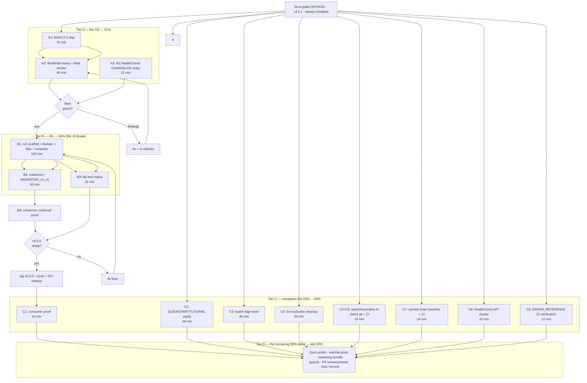

# Pareto Execution Plan — Post-Sweep Roadmap (2026-11-08 02:32)

> **What this is.** The execution-ranked overlay for ALL open work in cmdguard
> after the 2026-11-07/08 docs-health sweep (95 docs annotated, 86 archived,
> docs-gates 5/5 PASS). It applies the Pareto discipline to the live
> TODO_LIST (T1–T5, P6–P13, D7, CT1–CT3, H1–H9, L6/L8, W1–W7, S1/S2) plus the
> sweep's §f discovery list, and breaks every item into ≤12-minute micro-tasks.
>
> **Relationship to existing plans.** The v5 thesis stays in
> [2026-11-01_v5-end-goal-paved-road.md](2026-11-01_v5-end-goal-paved-road.md)
> (workstreams M06–M17) and the release plan in
> [2026-11-02_00-38_pareto-v5-release-execution-plan.md](2026-11-02_00-38_pareto-v5-release-execution-plan.md).
> This document is the **ranked execution order + micro-task breakdown**; where
> an M-number exists, it is cited, not duplicated.
>
> **Current state (verified 2026-11-08 02:30):** HEAD `f2240dd`, tag v4.2.1,
> docs-gates 5/5 PASS, `nix flake check` green, `go build ./...` green,
> TODO_LIST carries H1–H9 + W1–W7 + legacy rows, ROADMAP carries 4 harvest
> clusters (~110 routed ideas).

---

## 1. The Pareto cut

Scoring: **customer value** (what consumers/fleet actually get) × **impact**
(risk removed / endgame progress) ÷ **effort**. The universe is 45 work items.

### 🎯 The 1% that delivers 51% — ONE workstream

<!-- check-rows:ledger -->

| #      | Workstream                                                                                                                                                                                                   | Why this is the 1%                                                                                                                                                                                                                                                                                                                                                    |
| ------ | ------------------------------------------------------------------------------------------------------------------------------------------------------------------------------------------------------------ | --------------------------------------------------------------------------------------------------------------------------------------------------------------------------------------------------------------------------------------------------------------------------------------------------------------------------------------------------------------------- |
| **A1** | **Ship `lint/v0.2.0` + BuildFlow bump + fleet baseline** (TODO P6) — with **W1 folded in** (the CHANGELOG entry for the silently-shipped `CLI.HealthCheck(ctx)` breaking change rides the same release docs) | The lint module's ENTIRE payoff (CG007/CG008, baseline ratchet, enable/disable options — all built and tested) is stranded until this tag ships and BuildFlow consumes it. One workstream activates 8 rules fleet-wide, closes the "built but not delivered" gap, and fixes the one undocumented breaking change. Everything else is incremental; this is the payoff. |

### 🎯 The 4% that delivers 64% — the v5 break begins

<!-- check-rows:ledger -->

| #      | Workstream                                                                                                  | Why                                                                                              |
| ------ | ----------------------------------------------------------------------------------------------------------- | ------------------------------------------------------------------------------------------------ |
| **B1** | **v5 scaffold + Builder + default flips + renames** (TODO P8 = M11–M15 + D7 + T1–T5 + L8 CurrentMajor bump) | The endgame major. Unblocked since the 2026-11-02 owner decisions (`/v5` module path, flips on). |
| **B2** | **Codemod + `MIGRATION_v4_v5.md`** (TODO P9 = M13–M16)                                                      | "Makes the break payable" — without it B1 strands every consumer.                                |

(A1 + B1 + B2 ≈ 4% of the universe → ~64% of strategic value.)

### 🎯 The 20% that delivers 80%

A-tier + B-tier, plus:

<!-- check-rows:ledger -->

| #  | Task                                                                                                      | Why it's in the 20%                                        |
| -- | --------------------------------------------------------------------------------------------------------- | ---------------------------------------------------------- |
| C1 | Consumer proof: erraudit + timesheets against v4.2.1 (P7)                                                 | Adopted-consumer evidence for the release                  |
| C2 | QUICKSTART + TUTORIAL parity (P12) — batteries/describe/hints currently have **zero** QUICKSTART mentions | First-touch docs lie today                                 |
| C3 | koanf→JSON round-trip edge tests (H3)                                                                     | Config loading is core; uncovered formats are real risk    |
| C4 | Dead `pkg/cmdguard/v2` lint-exclusion cleanup (H5, ~20 rules)                                             | Config hygiene; makes every future lint signal trustworthy |
| C5 | `examples/taskctl` into `check-all` (H8)                                                                  | local-green ≠ CI-green is a correctness hole               |
| C6 | Examples tested in CI (H1)                                                                                | Same class as C5                                           |
| C7 | samber-linter baseline committed + CI wiring (W6)                                                         | Prevents the next HW-2-class silent drift                  |
| C8 | `CLI.HealthCheckWithContext` dedupe + `Scope` split-brain fix + conformance guards (W2+W3+W4)             | Closes the HW-2 API-wart cluster                           |
| C9 | `docs/ERROR_REFERENCE.md` CI-regeneration verification (P10 residue)                                      | Docs-cannot-drift guarantee                                |

(A1 + B + C1–C9 ≈ 20% of the universe → ~80% of total value.)

### The remaining 80% of items → final 20% of value

Marketing/website ports, doc-CI guards, FR enhancements, misc harvest
(U28–U45 below), plus HTFC cleanup items. Real, but none block a consumer.

---

## 2. TABLE VIEW — Comprehensive plan (30–100 min tasks, ALL todos, Pareto-sorted)

<!-- check-rows:ledger -->

| #  | Tier | Task (source)                                                                                                                                                                                         | Est      | Value driver                                         |
| -- | ---- | ----------------------------------------------------------------------------------------------------------------------------------------------------------------------------------------------------- | -------- | ---------------------------------------------------- |
| 1  | A    | Ship `lint/v0.2.0`: restore publish shape (real pin + version-scoped replace), lockstep dep bumps, CHANGELOG, tag, proxy-verify, GH release                                                           | 75 min   | Fleet activation of CG007/CG008 + baseline + options |
| 2  | A    | BuildFlow bump to lint/v0.2.0: require + vendorHash, wiring tests, `docs --check`, fleet smoke on 3 consumer repos                                                                                    | 40 min   | The fleet actually gets the new rules                |
| 3  | A    | W1: CHANGELOG breaking-change entry for `CLI.HealthCheck(ctx)` (ride the next release section; owner decision on retro-insert per §g2)                                                                | 12 min   | Trust — no silent breaking changes                   |
| 4  | B    | v5 scaffold: `/v5` module path, Builder, flips on (strict/signals/batteries), T1–T5 renames, L8 CurrentMajor bump (M11–M12+M15)                                                                       | 100 min  | The major begins                                     |
| 5  | B    | v5 default-flip test matrix: opt-outs stay green, batteries-on suite green (M15)                                                                                                                      | 45 min   | The flip is provably safe                            |
| 6  | B    | Codemod: import-path rewriter + rename rewriter, dry-run on erraudit/timesheets (M13)                                                                                                                 | 60 min   | Break becomes payable                                |
| 7  | B    | `MIGRATION_v4_v5.md`: flip list, codemod usage, rename table (M16)                                                                                                                                    | 45 min   | Consumers can migrate in one sitting                 |
| 8  | C    | Consumer proof: build + full tests of erraudit + timesheets vs HEAD (P7)                                                                                                                              | 40 min   | Adopted-consumer evidence                            |
| 9  | C    | QUICKSTART parity: batteries, `describe`, hints, runtime tag semantics (P12)                                                                                                                          | 60 min   | First-touch docs stop lying                          |
| 10 | C    | TUTORIAL parity pass (P12b)                                                                                                                                                                           | 45 min   | Same                                                 |
| 11 | C    | koanf edge tests: TOML datetimes, YAML anchors, int-vs-float64, empty/0-byte (H3)                                                                                                                     | 60 min   | Config-core risk                                     |
| 12 | C    | `.golangci.yml` v2-exclusion cleanup (H5) + art-dupl re-run                                                                                                                                           | 30 min   | Trustworthy lint signals                             |
| 13 | C    | `check-all` + CI: taskctl + examples jobs (H8+H1)                                                                                                                                                     | 40 min   | local-green = CI-green                               |
| 14 | C    | samber-linter baseline file + flake/CI wiring (W6)                                                                                                                                                    | 45 min   | No silent drift class repeats                        |
| 15 | C    | HealthCheck API cluster: dedupe WithContext (W2), Scope split-brain (W3), conformance guards (W4)                                                                                                     | 50 min   | HW-2 warts closed                                    |
| 16 | C    | ERROR_REFERENCE CI-regeneration verification + wire `-update-golden` check (P10)                                                                                                                      | 20 min   | Docs-cannot-drift, proven                            |
| 17 | C    | HealthCheck cancellation tests (W5)                                                                                                                                                                   | 30 min   | Context-awareness proven                             |
| 18 | D    | W7: README/doc.go healthcheck docs refresh                                                                                                                                                            | 20 min   | Doc accuracy                                         |
| 19 | D    | H2: rewrite/delete no-op `TestPromptConfirm`                                                                                                                                                          | 12 min   | Test honesty                                         |
| 20 | D    | H4: hero-code sync guard (single-source derive or diff test)                                                                                                                                          | 30 min   | Website integrity                                    |
| 21 | D    | H6: COMPARISON.md v4 prose audit + header date                                                                                                                                                        | 40 min   | Doc accuracy                                         |
| 22 | D    | H7: GitHub release pages v4.0.0/v4.0.1 (+ v0.2.0s)                                                                                                                                                    | 25 min   | Release completeness                                 |
| 23 | D    | H9: lint resolveImports dot/blank fixture test                                                                                                                                                        | 30 min   | Coverage                                             |
| 24 | D    | CT2: schema sub-module release decision (ship v0.1.0 vs hold)                                                                                                                                         | 20 min   | Surface clarity                                      |
| 25 | D    | CT3: wire config-explain into README + website                                                                                                                                                        | 25 min   | Feature discoverability                              |
| 26 | D    | S2: toolchain go1.27.2 when nixpkgs ships (re-check + flip)                                                                                                                                           | 15 min   | Security                                             |
| 27 | D    | Website guide ports ×8 (TUTORIAL/COMPARISON/PERFORMANCE/CLI_DESIGN_PRINCIPLES/MIGRATION_v2_v3/COBRA_FOOTGUNS/Doctor/Signal)                                                                           | 100 min+ | Docs reach                                           |
| 28 | D    | Launch marketing & infra bundle (logo, OG, Lighthouse, preview channels, DNS, secret, uptime, SECURITY.md, FUNDING, CITATION, lastmod, full-tutorial, dedup.sh, blog/Awesome/wiki, badges, flake app) | 100 min+ | Launch reach                                         |
| 29 | D    | Doc & CI guards bundle (check-dep-versions, stale-ref guard, semver check, godoclint, markdownlint+lychee, docs-health gate, STATUS.md index)                                                         | 100 min+ | Doc-drift class killed                               |
| 30 | D    | FR enhancement batch (30 ROADMAP bullets — pull on first consumer demand)                                                                                                                             | open     | Feature depth                                        |
| 31 | D    | Misc harvest (RenderOptions, command-scoped middleware, lite, `Run[T,F]`, PrintHelp, go.work portability, …)                                                                                          | open     | Idea backlog                                         |
| 32 | D    | L6: golangci-lint module-plugin layer (needs Analyzer bridge — do not half-ship)                                                                                                                      | 100 min+ | Distribution                                         |
| 33 | D    | HTFC: gopls infertypeargs verification run (settle the UNVERIFIED)                                                                                                                                    | 12 min   | Settle a flag                                        |
| 34 | D    | HTFC: git-town/library-policy value verification                                                                                                                                                      | 12 min   | Settle a flag                                        |
| 35 | D    | docs-gates upstream: file routed-verdict divergence (scratch repro exists) or template-fix                                                                                                            | 30 min   | Tooling canon                                        |
| 36 | D    | Derive FEATURES/AGENTS dep tables + test counts from `go.mod`/`go test -list`                                                                                                                         | 60 min   | Kills the version-drift class                        |
| 37 | D    | Archive decision follow-through: annotate+archive 2026-10 batch (restore 15/21) OR keep thresholds                                                                                                    | 60 min   | Cadence policy                                       |
| 38 | D    | Eyeball-pass re-rendered `architecture.svg` + examples/README test-loop coverage                                                                                                                      | 12 min   | Polish                                               |
| 39 | D    | Archive `2026-11-02_00-11` HTML with its .md siblings                                                                                                                                                 | 5 min    | Consistency                                          |
| 40 | D    | ROADMAP idea intake review cadence (quarterly trim)                                                                                                                                                   | 30 min   | Backlog hygiene                                      |

(TODO T1–T5 are inside #4; D7 inside #4/#5; L8 inside #4; CT1 stays an idea.)

---

## 3. TABLE VIEW — Micro-tasks (≤12 min each, ALL todos)

Sorted in execution order. T = tier. "☐" = ready to execute.

### Tier A — the 1% (do first)

<!-- check-rows:ledger -->

| ☐ | Micro-task                                                                                                         | ≤    | Parent |
| - | ------------------------------------------------------------------------------------------------------------------ | ---- | ------ |
| ☐ | A1.1 Restore `lint/go.mod` publish shape: real pin `cmdguard/v4 v4.2.1` + version-scoped `replace … v4.2.1 => ../` | 8 m  | #1     |
| ☐ | A1.2 Lockstep-check go-finding/toolsdk/go-linter-sdk versions compile (`go build ./...` in lint/)                  | 6 m  | #1     |
| ☐ | A1.3 `lint/CHANGELOG.md` + root CHANGELOG `lint/v0.2.0` section (CG007/CG008, baseline, options, crossfile)        | 10 m | #1     |
| ☐ | A1.4 Full lint test suite + `cmdguard-lint` dogfood run on cmdguard itself                                         | 10 m | #1     |
| ☐ | A1.5 Annotated tag `lint/v0.2.0` + push; proxy-verify via scratch consumer (`go get` + build + run)                | 12 m | #1     |
| ☐ | A1.6 GitHub release page for lint/v0.2.0                                                                           | 5 m  | #1     |
| ☐ | A2.1 BuildFlow: bump require to v0.2.0 + adjust vendorHash                                                         | 10 m | #2     |
| ☐ | A2.2 BuildFlow wiring tests + `docs --check` (provider count) green                                                | 10 m | #2     |
| ☐ | A2.3 Fleet smoke: run cmdguard-lint on erraudit/timesheets + one more consumer; record findings                    | 12 m | #2     |
| ☐ | A2.4 Commit BuildFlow bump (separate repo, own message)                                                            | 5 m  | #2     |
| ☐ | A3.1 W1: draft the `CLI.HealthCheck(ctx)` breaking-change entry; insert per owner's §g2 answer                     | 12 m | #3     |

### Tier B — the 4%

<!-- check-rows:ledger -->

| ☐ | Micro-task                                                                                 | ≤    | Parent |
| - | ------------------------------------------------------------------------------------------ | ---- | ------ |
| ☐ | B1.1 Branch `v5-scaffold`; copy tree to `/v5`; rewrite module path + imports               | 12 m | #4     |
| ☐ | B1.2 `/v5` compiles standalone (GOWORK=off build gate)                                     | 10 m | #4     |
| ☐ | B1.3 Builder type sketch (`NewApp` evolution, options struct)                              | 12 m | #4     |
| ☐ | B1.4 Flip strict-validation default; fix fallout tests                                     | 12 m | #4     |
| ☐ | B1.5 Flip signals+graceful default; fix fallout tests                                      | 12 m | #4     |
| ☐ | B1.6 Flip batteries default; fix fallout tests                                             | 12 m | #4     |
| ☐ | B1.7 T1 rename `CommandInfo` → `CommandMetadata` (+ codemod rule entry)                    | 8 m  | #4     |
| ☐ | B1.8 T2 rename `TypeHandler` → `TypeCodec` (+ deprecation alias decision)                  | 12 m | #4     |
| ☐ | B1.9 T3 rename `PromptRunner`; T4 remove `SetConfig`; T5 generic `RegisterInScope` removal | 12 m | #4     |
| ☐ | B1.10 L8: bump `CurrentMajor` in `lint/walk.go`; CG002 corpus re-verify                    | 8 m  | #4     |
| ☐ | B1.11 Delete all `TODO(v5)` markers; godox exclusion removal                               | 6 m  | #4     |
| ☐ | B2.1 Codemod skeleton: import rewrite `/v4`→`/v5`                                          | 12 m | #6     |
| ☐ | B2.2 Codemod: rename rewrites (metadata/codec/promptRunner)                                | 12 m | #6     |
| ☐ | B2.3 Dry-run codemod on erraudit; diff review                                              | 12 m | #6     |
| ☐ | B2.4 Dry-run codemod on timesheets; diff review                                            | 12 m | #6     |
| ☐ | B2.5 `MIGRATION_v4_v5.md`: flips + renames + codemod usage                                 | 12 m | #7     |
| ☐ | B2.6 Migration guide: worked example (taskctl as the before/after)                         | 12 m | #7     |
| ☐ | B3.1 v5 flip test matrix: opt-outs (`Without*`) each prove green                           | 12 m | #5     |
| ☐ | B3.2 Batteries-on suite under `/v5` defaults green; race + lint                            | 12 m | #5     |

### Tier C — completes the 20%

<!-- check-rows:ledger -->

| ☐ | Micro-task                                                                         | ≤    | Parent |
| - | ---------------------------------------------------------------------------------- | ---- | ------ |
| ☐ | C1.1 erraudit: build + full tests vs HEAD; record evidence                         | 12 m | #8     |
| ☐ | C1.2 timesheets: build + full tests vs HEAD; record evidence                       | 12 m | #8     |
| ☐ | C2.1 QUICKSTART: batteries + `NewApp` quickstart swap                              | 12 m | #9     |
| ☐ | C2.2 QUICKSTART: `describe` contract + hints section                               | 12 m | #9     |
| ☐ | C2.3 QUICKSTART: runtime tag semantics (required/values/validate) snippet          | 12 m | #9     |
| ☐ | C2.4 TUTORIAL parity pass, chapter by chapter                                      | 12 m | #10    |
| ☐ | C3.1 koanf test: TOML datetimes round-trip                                         | 12 m | #11    |
| ☐ | C3.2 koanf test: YAML anchors + merge keys                                         | 12 m | #11    |
| ☐ | C3.3 koanf test: int-vs-float64 + empty/0-byte file                                | 12 m | #11    |
| ☐ | C4.1 Remove dead v2 path exclusions from `.golangci.yml` (~20 rules)               | 12 m | #12    |
| ☐ | C4.2 art-dupl re-run post-cleanup; record group count                              | 8 m  | #12    |
| ☐ | C5.1 flake `check-all`: add examples/taskctl leg                                   | 12 m | #13    |
| ☐ | C6.1 CI `examples.yml`-style job (or ci.yml matrix leg) for examples tests         | 12 m | #13    |
| ☐ | C7.1 samber-linter baseline file committed (`--write-baseline` equivalent)         | 12 m | #14    |
| ☐ | C7.2 Wire the linter into flake check / CI lint leg                                | 12 m | #14    |
| ☐ | C8.1 Dedupe `CLI.HealthCheckWithContext` (delegate or deprecate)                   | 12 m | #15    |
| ☐ | C8.2 `Scope` split-brain: WithContext delegates to HealthCheck                     | 12 m | #15    |
| ☐ | C8.3 `var _ do.HealthcheckerWithContext` conformance guards (CLI + Scope)          | 8 m  | #15    |
| ☐ | C9.1 Verify ERROR_REFERENCE `-update-golden` drift test runs in CI; wire if absent | 12 m | #16    |
| ☐ | C10.1 HealthCheck cancellation tests (cancelled ctx → error path)                  | 12 m | #17    |

### Tier D — the remaining 80% (first ≤12-min slice each; clusters expand on start)

<!-- check-rows:ledger -->

| ☐ | Micro-task (first slice)                                                   | ≤       | Parent |
| - | -------------------------------------------------------------------------- | ------- | ------ |
| ☐ | D18.1 README/doc.go healthcheck docs refresh                               | 12 m    | #18    |
| ☐ | D19.1 PromptConfirm test: rewrite against prompts sub-module or delete     | 12 m    | #19    |
| ☐ | D20.1 hero-code: extract single source + derive highlighted version        | 12 m    | #20    |
| ☐ | D21.1 COMPARISON.md: v4 claims pass 1 of 3                                 | 12 m    | #21    |
| ☐ | D22.1 GH release pages v4.0.0 + v4.0.1 from CHANGELOG sections             | 12 m    | #22    |
| ☐ | D23.1 lint fixture: dot-import file + blank-import file + assertions       | 12 m    | #23    |
| ☐ | D24.1 CT2 decision memo (ship v0.1.0 vs hold; owner sign-off)              | 12 m    | #24    |
| ☐ | D25.1 config-explain: README section + website link                        | 12 m    | #25    |
| ☐ | D26.1 S2: `nix eval nixpkgs#go_1_27.version` re-check; flip if ≥1.27.2     | 12 m    | #26    |
| ☐ | D27.1–8 Website ports: one ≤12-min port per guide (TUTORIAL first)         | 12 m ea | #27    |
| ☐ | D28.1–17 Marketing/infra: SECURITY.md first (5 m), then one item per slice | 12 m ea | #28    |
| ☐ | D29.1–15 Guards: stale-doc-ref guard first, then one guard per slice       | 12 m ea | #29    |
| ☐ | D30.x FR enhancements: pull only on first consumer demand                  | —       | #30    |
| ☐ | D31.x Misc harvest: pull only on demand                                    | —       | #31    |
| ☐ | D32.1 L6 spike: go-humanize-linter Analyzer-bridge pattern study           | 12 m    | #32    |
| ☐ | D33.1 `gopls check` run; record infertypeargs verdict                      | 12 m    | #33    |
| ☐ | D34.1 Read git-town.toml + library-policy.yaml; record values              | 12 m    | #34    |
| ☐ | D35.1 File docs-gates divergence upstream (repro attached)                 | 12 m    | #35    |
| ☐ | D36.1 Script: derive dep tables from go.mod → diff vs FEATURES/AGENTS      | 12 m    | #36    |
| ☐ | D37.1 Execute the §g1 decision on 2026-10 batch / thresholds               | 12 m    | #37    |
| ☐ | D38.1 Eyeball architecture.svg; examples/README test loop                  | 12 m    | #38    |
| ☐ | D39.1 Archive the 00-11 HTML                                               | 5 m     | #39    |
| ☐ | D40.1 Quarterly ROADMAP trim (calendar note)                               | 12 m    | #40    |

---

## 4. Execution graph

---

## 5. Verification gates (per phase)

| Phase | Gate |
| ----- | ---- |

<!-- check-rows:ledger -->

| Every micro-task | `go build ./...` green (or the touched module's build) |
| Tier A | `docs-gates run .` 5/5; scratch-consumer `go get` resolves; BuildFlow `docs --check` provider count unchanged-or-bumped |
| Tier B | `/v5` GOWORK=off build; flip test matrix green; codemod dry-run diffs reviewed by owner; `-race` + `golangci-lint` clean |
| Tier C | erraudit/timesheets full suites green; new tests actually assert (no no-ops); CI legs green |
| Tier D | Per-item: the slice either lands a file or records an explicit decision |

**Verschlimmbesserung guardrails** (per the standing threat): no code-formatting passes over annotated archive tables without a follow-up `check-rows`; no default flip without its opt-out test; no CHANGELOG rewrite of published sections without an owner answer to §g2 of the status report; no ROADMAP bullet deleted without recording where the idea went.

---

## 6. Time budget summary

<!-- check-rows:ledger -->

| Tier    | Items | Micro-tasks      | Est. total             |
| ------- | ----- | ---------------- | ---------------------- |
| A (1%)  | 2     | 11               | ~2.2 h                 |
| B (4%)  | 3     | 20               | ~4 h                   |
| C (20%) | 10    | 16               | ~4.5 h                 |
| D (80%) | 30    | ~40 first-slices | open-ended, pull-based |

Tier A+B+C ≈ 11 hours of focused work → ~80% of the total achievable value.
