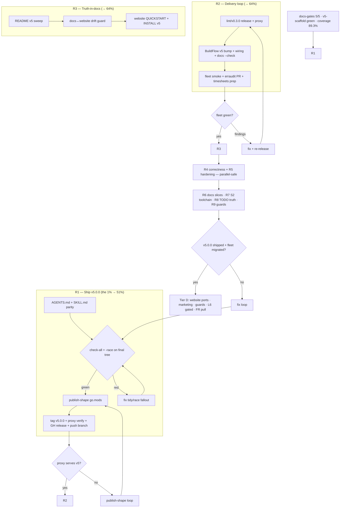

# Pareto Execution Plan v2 — Ship v5.0.0 and Everything Behind It (2026-11-08 08:42)

> **What this is.** The ranked execution plan for ALL remaining cmdguard work
> after the 08:04 whole-list run landed the v5 scaffold on the `v5-scaffold`
> branch (flips, Builder, codemod, migration guide, Tier C, gates 5/5). It
> applies the Pareto discipline to the post-purge TODO_LIST, the 08:32 audit's
> next-50, and the remaining Tier D universe.
>
> **Relationship to existing plans.** Supersedes
> [2026-11-08_02-32_pareto-post-sweep-execution-plan.md](2026-11-08_02-32_pareto-post-sweep-execution-plan.md)
> (Tier A shipped, Tier B/C executed). The v5 thesis stays in
> [2026-11-01_v5-end-goal-paved-road.md](2026-11-01_v5-end-goal-paved-road.md).
>
> **Current state (verified 2026-11-08 08:42):** branch `v5-scaffold`
> (local, unpushed), docs-gates 5/5 PASS, tests+lint green ×8 modules,
> flake check green, coverage 89.3%. Known debt: AGENTS.md/SKILL.md still
> v4-described, final `-race` + `check-all` not yet run on the final tree,
> CHANGELOG line 38 stale path.

---

## 1. The Pareto cut

### 🎯 The 1% that delivers 51% — ONE workstream

<!-- check-rows:ledger -->

| #      | Workstream                                                                                                                                                                                                                              | Why this is the 1%                                                                                                                                                              |
| ------ | --------------------------------------------------------------------------------------------------------------------------------------------------------------------------------------------------------------------------------------- | ------------------------------------------------------------------------------------------------------------------------------------------------------------------------------- |
| **R1** | **Ship `v5.0.0`** — AGENTS.md + SKILL.md v5 parity, CHANGELOG stale-path fix, end-to-end `check-all` + full `-race` on the final tree, publish-shape `go.mod`s, annotated tag, proxy verify, GH release page (MIGRATION as the notes)    | The entire scaffold (flips, Builder, renames, codemod, migration guide) is stranded until the tag exists. Every downstream item (lint/v0.3.0, BuildFlow v5, fleet PRs) needs the proxy to serve v5. |

### 🎯 The 4% that delivers 64% — the delivery loop closes

<!-- check-rows:ledger -->

| #      | Workstream                                                                                                                                                                                                 | Why                                                                                                                              |
| ------ | ---------------------------------------------------------------------------------------------------------------------------------------------------------------------------------------------------------- | -------------------------------------------------------------------------------------------------------------------------------- |
| **R2** | **Fleet + linter delivery loop** — `lint/v0.3.0` (CurrentMajor=v5, release shape), BuildFlow v5 bump (input + vendorHash + wiring tests + `docs --check`), fleet migration PRs (erraudit, timesheets when its WIP resolves) | Without this the new major ships but no consumer and no linter actually moves. The 03:56 report's "built but not delivered" gap repeats. |
| **R3** | **Truth-in-docs parity** — README full v5 sweep, docs↔website same-name-guide drift guard, CHANGELOG v4-path fix (folded into R1)                                                                                          | The repo currently disagrees with itself: docs/ teach v5, website teaches v4, AGENTS.md describes a tree that no longer exists.   |

(A1 + R1 + R2 + R3 ≈ 4% of the universe → ~64% of strategic value.)

### 🎯 The 20% that delivers 80%

R1–R3, plus:

<!-- check-rows:ledger -->

| #   | Task                                                                                                          | Why it's in the 20%                                              |
| --- | ------------------------------------------------------------------------------------------------------------- | ---------------------------------------------------------------- |
| R4  | Correctness batch: `-race` on final tree (R1 gate), strict positional-args default ticket+implementation, Builder race test, codemod round-trip test                 | The 08:32 audit confessed: newest code has never raced; the silent-positional footgun cost a wasted fleet pass |
| R5  | Hardening batch: `check-all` end-to-end (R1 gate), empty-file `LoadedPath` assertion, `WithoutBatteries` describe/doctor fixtures, flightrecorder survive-Execute test | Small, close real verification gaps                               |
| R6  | Docs slices: Builder section in QUICKSTART, config-explain links (CT3), COMPARISON.md audit (H6), samber-linter suppression config (33% floor → domain services)      | Trust and discoverability                                         |
| R7  | S2 toolchain flip — **unblocked**: nixpkgs `go_1_27` is now 1.27.3 ≥ 1.27.2; set `toolchain go1.27.2+`, `nix flake check` (6 stdlib vulns)                          | Security, was blocked, now one slice                              |
| R8  | TODO_LIST truth pass: P6/P10/P11 rows are stale-done (shipped in v4.2.0) — mark them; H9 lint fixture (dot/blank arms, 0 coverage)                                    | The list stops lying                                              |
| R9  | H4 hero-code sync guard; stale-ref guard (docs↔website, R3 overlap); migration runbook doc                                                                      | Kills the next silent-drift class                                 |

(R1–R9 ≈ 20% of the universe → ~80% of total value.)

### The remaining 80% of items → final 20% of value

Website guide ports ×8, M16 website sweep completion, launch marketing &
infra bundle (logo, OG, SECURITY.md, FUNDING, …), doc-CI guards bundle
(gomodirectives, semver check, godoclint CI, markdownlint+lychee), L6
golangci module-plugin (gated on Analyzer-bridge spike — do not half-ship),
FR enhancement batch (30 ROADMAP bullets, pull on demand), misc harvest,
HTFC items (settled this session).

---

## 2. TABLE VIEW — Comprehensive plan (30–100 min tasks, ALL todos)

<!-- check-rows:ledger -->

| #  | Tier | Task (source)                                                                                                                              | Est    | Value driver                                             |
| -- | ---- | ------------------------------------------------------------------------------------------------------------------------------------------ | ------ | -------------------------------------------------------- |
| 1  | R1   | AGENTS.md full v5 parity: paths, tree, module table, counts, coverage % (21 v4 refs)                                                        | 45m    | Future sessions stop being lied to                        |
| 2  | R1   | `.agents/skills/cmdguard/SKILL.md` v5 update: import path, renames, flips, flag-scoping lines (12 v4 refs) (03:56 item 14)                 | 30m    | Consumer AI sessions get the truth                        |
| 3  | R1   | CHANGELOG Unreleased stale regen path fix (line 38) + pkg/version sanity on branch                                                          | 10m    | Copy-paste commands work                                  |
| 4  | R1   | `nix run .#check-all` end-to-end; fix tidy-gate fallout (go.sum drift from daemon)                                                          | 20m    | The actual hard wall, not a recomposition                 |
| 5  | R1   | Full `-race` battery on the final tree (Builder/execCtx/shutdown/koanf never raced)                                                         | 15m    | Concurrency verification is real                          |
| 6  | R1   | Publish-shape `go.mod`s: root + 7 sub-modules (real pin + version-scoped replaces, sibling replaces kept)                                    | 30m    | The tag must be fetchable                                 |
| 7  | R1   | Tag `v5.0.0` annotated + push; proxy-verify via scratch consumer (build + describe + batteries + flips)                                      | 20m    | The 1% ships                                              |
| 8  | R1   | GH release v5.0.0: MIGRATION_v4_v5.md as the notes body + CHANGELOG delta                                                                   | 15m    | Consumers can migrate in one sitting                      |
| 9  | R1   | Push `v5-scaffold` branch (owner said push in the planning instruction; master policy still open — §g)                                      | 5m     | Work survives the machine                                 |
| 10 | R2   | `lint/v0.3.0`: release-shape go.mod, CHANGELOG (CurrentMajor=v5 note), tag, proxy verify, GH release                                        | 40m    | The linter enforces the v5 baseline                       |
| 11 | R2   | BuildFlow v5 bump: cmdguard input → v5 tag, lint require → v0.3.0, vendorHash, wiring tests, `docs --check`                                 | 40m    | 118-provider fleet gets the new major                     |
| 12 | R2   | BuildFlow fleet smoke: cmdguard-lint (v5 major) on erraudit/timesheets/gsl/bf; record CG002 counts                                          | 20m    | Migration targets quantified                              |
| 13 | R2   | erraudit migration PR: codemod applied, tests green (dry-run proved it)                                                                     | 30m    | First real consumer on v5                                 |
| 14 | R2   | timesheets migration prep: hold PR until `internal/parser` WIP resolves; leave branch ready                                                 | 15m    | Second consumer queued, not forced                        |
| 15 | R3   | README full v5 sweep (features table, module table, install snippet, badges) — this session touched only 2 lines                            | 45m    | The sales page stops lying                                |
| 16 | R3   | Docs↔website drift guard: script comparing same-name guides (QUICKSTART/TUTORIAL/…) headings; wire into check-all                           | 40m    | Kills the next silent-drift class                         |
| 17 | R3   | Website QUICKSTART + INSTALL v5 rewrite (M16 first two pages)                                                                               | 40m    | Public docs stop teaching v4                              |
| 18 | R4   | Strict positional-args default: leaf commands validate arg count unless `WithArgsPassthrough()`; fix dogfood CLI + taskctl fallout; ROADMAP bullet already exists | 60m | The silent-ignore footgun dies                            |
| 19 | R4   | Builder race test: parallel `Add` from goroutines + `Build` once                                                                          | 20m    | New API proven thread-safe or scoped                      |
| 20 | R4   | Race test: repeated `ExecuteWithArgs` interleaved with signal-cancel                                                                     | 20m    | The redesigned shutdown path proven under stress          |
| 21 | R4   | Codemod round-trip test: fixture consumer tree → codemod → `go build` + `cmdguard-lint` clean (30m)                                         | 30m    | The migration tool proven, not assumed                    |
| 22 | R5   | `KoanfLoader.LoadedPath` stays empty when all files empty/missing — assertion test                                                        | 10m    | Contract pin                                              |
| 23 | R5   | `WithoutBatteries` describe fixture: pin the reduced command tree (no doctor/version)                                                     | 10m    | Opt-out contract proven in the contract JSON              |
| 24 | R5   | Doctor fixture: `WithoutBatteries` + no services → `0 passed, 0 failed` shape                                                            | 10m    | The shape tests assert today is batteries-on              |
| 25 | R5   | Flightrecorder: explicit test that slow-capture completes after Execute returns (the `WithoutCancel` fix)                                 | 15m    | Post-hoc telemetry contract                               |
| 26 | R6   | QUICKSTART: Builder section (ladder-free construction)                                                                                    | 15m    | First-touch docs teach the new shape                      |
| 27 | R6   | CT3: config-explain demo linked from README + website related-tools                                                                       | 20m    | Feature discoverability                                   |
| 28 | R6   | COMPARISON.md audit (H6): header date, v5 claims pass 1 of 3                                                                              | 30m    | Doc accuracy                                              |
| 29 | R6   | samber-linter suppressions for framework internals (`*T`, FlagRegistry) so the floor measures domain services                              | 15m    | The ratchet becomes meaningful                            |
| 30 | R6   | Migration runbook: consumers × codemod × lint ratchet × verification, one doc                                                              | 30m    | The fleet migration becomes mechanical                    |
| 31 | R7   | S2 toolchain flip: `toolchain go1.27.3` directive (nixpkgs ships 1.27.3), `nix flake check`, govulncheck re-run                            | 15m    | 6 stdlib vulns cleared (was blocked, now unblocked)       |
| 32 | R8   | TODO_LIST truth pass: mark P6/P10/P11 stale-done (shipped v4.2.0); archive 37-day-old 2026-10-02 status batch (cadence headroom)           | 20m    | The list stops lying                                      |
| 33 | R8   | H9 lint fixture: dot-import + blank-import files; resolveImports arms to 100%                                                             | 20m    | Coverage hole closed                                      |
| 34 | R9   | H4 hero-code sync guard: derive `hero-code.ts` from the highlighted copy or diff-test them                                                | 30m    | Website integrity                                         |
| 35 | R9   | H7 residue: GH release pages for v4.1.0 check (exists), v0.2.0 sub-module pages if any missing                                            | 10m    | Release completeness                                      |
| 36 | D    | Website guide ports ×8: TUTORIAL, COMPARISON, PERFORMANCE, CLI_DESIGN_PRINCIPLES, MIGRATION_v3_v4, COBRA_FOOTGUNS, Doctor, Signal          | 100m+  | Docs reach                                                |
| 37 | D    | Launch marketing & infra bundle: logo, OG image, Lighthouse pass, SECURITY.md, FUNDING, CITATION, lastmod, blog/Awesome/wiki, badges      | 100m+  | Launch reach                                              |
| 38 | D    | Doc-CI guards bundle: check-dep-versions, semver check, godoclint CI leg, markdownlint, lychee link check, STATUS index                    | 100m+  | Doc-drift class killed                                    |
| 39 | D    | L6 golangci module-plugin — ONLY after the Analyzer-bridge spike proves the pattern (go-humanize-linter `lint/plugin/` reference)          | 100m+  | Distribution (gated, do not half-ship)                    |
| 40 | D    | FR enhancement batch (30 ROADMAP bullets) — pull on first consumer demand                                                                 | open   | Feature depth                                             |
| 41 | D    | Misc harvest: RenderOptions, command-scoped middleware, lite build, `Run[T,F]`, PrintHelp, go.work portability                             | open   | Idea backlog                                              |
| 42 | D    | Derive FEATURES/AGENTS dep tables + test counts from go.mod / `go test -list` (kills version-drift class)                                   | 60m    | Meta-accuracy                                             |
| 43 | D    | HTFC settled items: record verdicts in their repo TODO (D33/D34 done this session)                                                        | 10m    | Cross-repo hygiene                                        |
| 44 | D    | Owner-gated queue: branch policy, `go install` fix path, BuildFlow push, fleet soak — execute per answers (§g of 08:32 report)             | varies | Unblocks 9, 13, 14                                        |

(TODO_LIST genuinely-open rows map: CT3→#27, H4→#34, H6→#28, H9→#33, L6→#39,
S2→#31, P6/P10/P11→stale-done→#32.)

---

## 3. TABLE VIEW — Micro-tasks (≤12 min each, ALL todos)

Sorted in execution order. T = tier. All reference the parent task in §2.

### R1 — Ship v5.0.0 (the 1%)

<!-- check-rows:ledger -->

| ☐ | Micro-task                                                                                    | ≤   | Parent |
| - | --------------------------------------------------------------------------------------------- | --- | ------ |
| ☐ | R1.1 AGENTS.md: rewrite Quick Start + structure tree + module table to v5                     | 12m | #1     |
| ☐ | R1.2 AGENTS.md: refresh counts (test functions, coverage 89.3%), package guidelines table     | 12m | #1     |
| ☐ | R1.3 AGENTS.md: sweep remaining v4 refs (grep -c v4 → 0 in prose; CHANGELOG links stay)       | 12m | #1     |
| ☐ | R1.4 SKILL.md: import path + renames table (CommandMetadata/TypeCodec/HuhPrompter)            | 12m | #2     |
| ☐ | R1.5 SKILL.md: flag-scoping section source lines re-anchored; flips documented                | 12m | #2     |
| ☐ | R1.6 CHANGELOG line 38: `pkg/cmdguard/v4` → `v5` in regen command                             | 2m  | #3     |
| ☐ | R1.7 pkg/version on branch: assert resolve() reports v5-era module path from buildinfo         | 8m  | #3     |
| ☐ | R1.8 `nix run .#check-all`; triage tidy-gate findings per module                              | 12m | #4     |
| ☐ | R1.9 Fix whatever check-all found (expected: go.sum drift)                                    | 12m | #4     |
| ☐ | R1.10 Full `-race` battery root + 7 sub-modules on final tree                                 | 12m | #5     |
| ☐ | R1.11 Publish shapes: root go.mod (drop nothing; verify require pins)                         | 12m | #6     |
| ☐ | R1.12 Publish shapes: sub-module go.mods — real pin `v5.0.0-00010101000000-000000000000` + version-scoped replaces, sibling replaces kept | 12m | #6     |
| ☐ | R1.13 Scratch consumer: `go get github.com/larsartmann/cmdguard/v5@v5.0.0` + build + run describe | 12m | #7  |
| ☐ | R1.14 Annotated tag `v5.0.0` + push; poll proxy until served                                   | 12m | #7     |
| ☐ | R1.15 GH release v5.0.0 (MIGRATION body + CHANGELOG delta + `--latest`)                        | 12m | #8     |
| ☐ | R1.16 Push `v5-scaffold` branch; set upstream                                                 | 5m  | #9     |

### R2 — Delivery loop (the path to 64%)

<!-- check-rows:ledger -->

| ☐ | Micro-task                                                                                 | ≤   | Parent |
| - | ------------------------------------------------------------------------------------------ | --- | ------ |
| ☐ | R2.1 lint release shape: go.mod real pin `cmdguard/v5 v5.0.0` + version-scoped replace      | 12m | #10    |
| ☐ | R2.2 lint/CHANGELOG v0.3.0 section (CurrentMajor v5 note) + root CHANGELOG mirror           | 12m | #10    |
| ☐ | R2.3 lint full tests + dogfood run on cmdguard itself (v5 tree)                             | 12m | #10    |
| ☐ | R2.4 Tag `lint/v0.3.0` + push + proxy verify + GH release                                   | 12m | #10    |
| ☐ | R2.5 BuildFlow: cmdguard flake input → v5.0.0 tag                                           | 12m | #11    |
| ☐ | R2.6 BuildFlow: tools go.mod lint require → v0.3.0 + vendorHash cycle                       | 12m | #11    |
| ☐ | R2.7 BuildFlow wiring tests + `docs --check` provider count green                           | 12m | #11    |
| ☐ | R2.8 Fleet smoke: v5-linter on erraudit/timesheets/gsl/bf; record counts                    | 12m | #12    |
| ☐ | R2.9 erraudit branch: apply codemod, tidy, build, full tests (reuse the proven dry-run)     | 12m | #13    |
| ☐ | R2.10 erraudit PR opened with evidence block                                                | 12m | #13    |
| ☐ | R2.11 timesheets: prep branch from committed HEAD (WIP hold note in its TODO_LIST)          | 12m | #14    |

### R3 — Truth-in-docs (to 64%)

<!-- check-rows:ledger -->

| ☐ | Micro-task                                                                                  | ≤   | Parent |
| - | ------------------------------------------------------------------------------------------- | --- | ------ |
| ☐ | R3.1 README: features table + module table v5 rewrite                                       | 12m | #15    |
| ☐ | R3.2 README: install/quickstart snippets + sub-module list v5                                | 12m | #15    |
| ☐ | R3.3 README: badges/version claims sweep; grep v4 → 0 (CHANGELOG/history links stay)         | 12m | #15    |
| ☐ | R3.4 Drift guard script: `scripts/check-guide-sync.sh` compares docs/ vs website/ guide H2s  | 12m | #16    |
| ☐ | R3.5 Wire drift guard into flake check + CI lint leg                                        | 12m | #16    |
| ☐ | R3.6 Website quick-start.mdx v5 rewrite                                                      | 12m | #17    |
| ☐ | R3.7 Website installation.mdx v5 rewrite                                                     | 12m | #17    |

### R4 — Correctness (to 80%)

<!-- check-rows:ledger -->

| ☐ | Micro-task                                                                                   | ≤   | Parent |
| - | ------------------------------------------------------------------------------------------- | --- | ------ |
| ☐ | R4.1 `WithArgsPassthrough()` option + default leaf-args validator (design + impl)           | 12m | #18    |
| ☐ | R4.2 Fix fallout: dogfood CLI + taskctl + examples args                                      | 12m | #18    |
| ☐ | R4.3 Tests: silent-positional now errors; passthrough still works                            | 12m | #18    |
| ☐ | R4.4 Builder race test: parallel Add + single Build                                          | 12m | #19    |
| ☐ | R4.5 Race test: ExecuteWithArgs × signal-cancel interleave                                   | 12m | #20    |
| ☐ | R4.6 Codemod round-trip fixture tree + build assertion                                       | 12m | #21    |
| ☐ | R4.7 Round-trip: run codemod in CI-able script + lint the result                             | 12m | #21    |

### R5+R6+R7+R8+R9 — hardening, docs, security, truth (to 80%)

<!-- check-rows:ledger -->

| ☐ | Micro-task                                                                                   | ≤   | Parent |
| - | ------------------------------------------------------------------------------------------- | --- | ------ |
| ☐ | R5.1 LoadedPath empty-skip assertion test                                                    | 10m | #22    |
| ☐ | R5.2 WithoutBatteries describe fixture (reduced tree pinned)                                 | 10m | #23    |
| ☐ | R5.3 Doctor 0/0 fixture (WithoutBatteries, no services)                                      | 10m | #24    |
| ☐ | R5.4 Flightrecorder capture-survives-Execute test                                            | 12m | #25    |
| ☐ | R6.1 QUICKSTART Builder section                                                              | 12m | #26    |
| ☐ | R6.2 CT3: README config-explain link                                                        | 10m | #27    |
| ☐ | R6.3 CT3: website related-tools config-explain entry                                         | 10m | #27    |
| ☐ | R6.4 COMPARISON.md header date + first-pass claims audit                                     | 12m | #28    |
| ☐ | R6.5 samber-linter suppression config for `*T`/FlagRegistry; re-baseline                     | 12m | #29    |
| ☐ | R6.6 Migration runbook doc (consumers × codemod × lint)                                      | 12m | #30    |
| ☐ | R7.1 `toolchain go1.27.3` directive; `nix flake check`                                       | 8m  | #31    |
| ☐ | R7.2 govulncheck re-run; record GO-2026-* cleared                                            | 8m  | #31    |
| ☐ | R8.1 TODO_LIST: P6/P10/P11 → stale-done with evidence pointers                               | 8m  | #32    |
| ☐ | R8.2 Archive 2026-10-02 status batch (cadence headroom)                                      | 10m | #32    |
| ☐ | R8.3 H9: lint dot/blank-import fixtures + assertions                                         | 12m | #33    |
| ☐ | R9.1 H4: hero-code derive/diff guard                                                         | 12m | #34    |
| ☐ | R9.2 H7 residue check: v4.1.0 + v0.2.0 sub-module release pages                              | 10m | #35    |
| ☐ | R9.3 Migration runbook: lint-ratchet section (baseline per consumer)                         | 12m | #30    |

### Tier D — the remaining 80% (first ≤12-min slices each; clusters expand on start)

<!-- check-rows:ledger -->

| ☐ | Micro-task (first slice)                                                                      | ≤       | Parent |
| - | --------------------------------------------------------------------------------------------- | ------- | ------ |
| ☐ | D36.1–8 Website ports: one guide per slice (TUTORIAL first, then the rest)                     | 12m ea  | #36    |
| ☐ | D37.1–17 Marketing/infra: SECURITY.md first (5m), then one item per slice                      | 12m ea  | #37    |
| ☐ | D38.1–15 Guards: check-dep-versions first, then one guard per slice                            | 12m ea  | #38    |
| ☐ | D39.x L6: Analyzer-bridge spike study FIRST (gate), then plugin package                        | 12m+    | #39    |
| ☐ | D40.x FR enhancements: pull only on first consumer demand                                      | —       | #40    |
| ☐ | D41.x Misc harvest: pull only on demand                                                        | —       | #41    |
| ☐ | D42.1 Script: derive dep tables from go.mod → diff vs FEATURES/AGENTS                          | 12m     | #42    |
| ☐ | D43.1 HTFC verdicts recorded in go-composable-business-types TODO                              | 10m     | #43    |
| ☐ | D44.1–4 Owner-gated: branch policy / go install / BuildFlow push / fleet soak (per §g answers) | varies  | #44    |

---

## 4. Execution graph

---

## 5. Verification gates (per phase)

<!-- check-rows:ledger -->

| Phase | Gate                                                                                                            |
| ----- | ---------------------------------------------------------------------------------------------------------------- |
| Every micro-task | touched module builds; touched tests pass                                                            |
| R1 | `nix run .#check-all` green END-TO-END; full `-race` green; scratch consumer builds from the tag; `docs-gates run .` 5/5 |
| R2 | lint/v0.3.0 proxy-served; BuildFlow wiring tests + `docs --check` green; erraudit PR suite green                    |
| R3 | drift guard green (docs↔website headings match); `grep -rn "\bv4\b" README.md docs/*.md` clean of stale claims       |
| R4 | new tests race-clean; strict-args fallout zero (dogfood + taskctl + examples)                                       |
| Tier D | per-item: the slice lands a file or records an explicit decision                                                |

**Verschlimmbesserung guardrails** (per the standing threat):

1. **Do not flip defaults again** — v5 flips are DONE and pinned by the
   matrix test; any further default change needs an owner decision + a new
   matrix row.
2. **No publish-shape experiment on the tagged path** — the go.mod shapes
   are settled by the 2026-11-02 playbook + the lint/v0.2.x precedent; do
   not "improve" them mid-release.
3. **No default flip without its opt-out test; no strike without on-disk
   evidence; no CHANGELOG rewrite of published sections without an owner
   answer** (carried from the 02:32 plan — still true).
4. **Do not migrate the fleet in-repo** until v5.0.0 is proxy-served; the
   /tmp dry-runs were proofs, not the migration.
5. **codemod is additive-only** — it may rewrite imports/identifiers, never
   delete code (SetConfig removal is a printed manual step, not a codemod
   deletion).

## 6. Time budget summary

<!-- check-rows:ledger -->

| Tier       | Items | Micro-tasks   | Est. total              |
| ---------- | ----- | ------------- | ----------------------- |
| R1 (1%)    | 1     | 16            | ~2.5 h                  |
| R2+R3 (4%) | 2     | 18            | ~3.5 h                  |
| R4–R9 (20%)| 6    | ~20           | ~4 h                    |
| Tier D     | 7 clusters | ~40 first-slices | open-ended, pull-based |

R1–R9 ≈ 10 hours of focused work → ~80% of the total achievable value.
