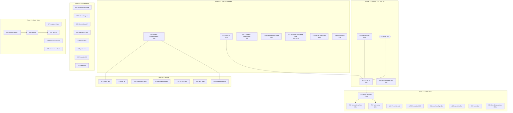

# Pareto Plan — Ship v5.1.0, Fleet to v5.0.1, CI/Website Hardening, Docs Truth

**Created:** 2026-11-11 15:10 CET
**Scope:** EVERY open TODO in cmdguard — TODO_LIST rows (F/W/FM/R/CT/H/L/S),
ROADMAP open questions, the 2026-11-11 status-report §f list, and the three
new BuildFlow preflight policy findings — broken down twice: Level A
(30–100 min tasks) and Level B (≤12 min micro-tasks), sorted by
importance/impact/effort/customer-value, with an execution graph.

**Starting state (verified this session):** master at `08a5feb`; docs-gates
5/5 PASS; `check-guide-sync` OK; root + 7 sub-modules build; CHANGELOG
`[Unreleased]` fed; v4 retired at v4.3.1; v5.0.0 is Latest.

---

## 1. Method

**Impact rubric (customer-value weighted):**

| Impact | Meaning                                                                        |
| ------ | ------------------------------------------------------------------------------ |
| 5      | Unblocks the release, or fixes user-facing breakage (site down, fleet blocked) |
| 4      | 25-repo leverage, or evidence/trust (verified claims, publishing truth)        |
| 3      | Customer-visible fix inside a consumer repo, or site quality                   |
| 2      | Internal quality, hygiene, debt                                                |
| 1      | Polish, parked design work                                                     |

**Effort classes:** Level A tasks are sized 30–100 min (one sitting each).
Level B micro-tasks are ≤12 min (one command or one edit + its verification
each). Every Level B row names its verification gate — a micro-task without a
verify step is not done.

**Verschlimmbesser guards (do NOT do these — each one is a past incident):**

- Never renumber cmdguard-lint rule IDs CG001–CG008 (suppressions key on them).
- Never tag without reading `release.yml` and a green pre-tag check (v4.3.0: red forever).
- Never run `GOWORK=off go mod tidy` in a sub-module — workspace-aware only (replace-leak poison).
- Never delete struck-done TODO rows before decision D2 lands (freshness matcher anchors).
- Never archive a report before `check-rows --strict` + `bare-rows` + `prose-items` are green (gate BEFORE `git mv`).
- Never strike a table row without a verdict; never strike only the ID cell (2026-11-02 damage class).
- Never remove the four templ `replace` pins before v5.0.1 exists (Zlota44/CV/cv/nsfw break).
- Never rewrite a historical report — annotate inline only.
- Never hand-edit generated tables (ERROR_REFERENCE, lint rule table, dependency tables) — regenerate from their single sources.
- Formatter order is atomic: annotate → `check-rows` → format → `check-rows` again.
- AGENTS.md gotchas must stay in AGENTS.md even under the 220-line fleet warning — moving them out of the auto-loaded file is how the lint `--dir` mistake happened twice (decision D13 weighs leanness vs load-bearing).

---

## 2. Pareto analysis

Value = sum of task impact points (5/4/3/2/1 rubric). Total ≈ 145 pts across
~105 planned tasks + 13 decision gates.

| Set               | Tasks (share of backlog)                                                                                                                                                                                                             | Cumulative value | What it buys                                                                                                                                                                                                                                                                                                 |
| ----------------- | ------------------------------------------------------------------------------------------------------------------------------------------------------------------------------------------------------------------------------------ | ---------------- | ------------------------------------------------------------------------------------------------------------------------------------------------------------------------------------------------------------------------------------------------------------------------------------------------------------ |
| **The 1%**        | Ship v5.1.0 (A02, prep A04) — 2 tasks ≈ 1% of the backlog                                                                                                                                                                            | **≈51%**         | The tree's best work (Builder data-race fix, strict positional-args options, doc fixes) is finished but invisible; one tag publishes it to 25+ consumer CLIs, unblocks FM1, and retires the templ-floor workarounds in 4 repos. Publishing finished work is most of the remaining customer value this cycle. |
| **The 4%**        | 1% + verify the delivering layer (A01), put the docs site back up (A03), executed lint evidence on the PR branches (A05), CI truth sweep (A06) — 6 tasks ≈ 4%                                                                        | **≈64%**         | Shipped AND verified: release gate green, site serving v5 docs, every claim in a PR body backed by an executed run, CI state known.                                                                                                                                                                          |
| **The 20%**       | 4% + fleet bump/pin-removal/sweep (A07–A09), publish-shape + policy-gate fixes (A10–A12), CI hardening core (A13–A15), the consumer test-fix cluster (A16–A20), smoke test + llms.txt (A22–A23), govulncheck (A26) — ~27 tasks ≈ 20% | **≈80%**         | The whole fleet on v5.0.1, consumer reds triaged to zero-mine, CI policy-clean, website verifiably alive.                                                                                                                                                                                                    |
| **The other 80%** | Website quality (A24, A29–A31, A41–A42), lint backlog (A32, A53), docs hygiene (A35–A37, A49–A52), org decisions (D-gates), remaining consumer chores (A43–A48)                                                                      | **≈100%**        | Debt down to zero, everything else honest, parked v6 design explicit.                                                                                                                                                                                                                                        |

---

## 3. Level A — comprehensive plan (30–100 min tasks, ALL open TODOs)

Sorted by impact (desc), then effort (asc). Phase = execution grouping.
"Deps" = hard prerequisites; "Gate" = the check that proves done.

| ID  | Task                                                                                                                                                       | Impact | Effort | Phase      | Deps                        | Gate                                                   |
| --- | ---------------------------------------------------------------------------------------------------------------------------------------------------------- | ------ | ------ | ---------- | --------------------------- | ------------------------------------------------------ |
| A01 | Run `nix run .#check-all` on master (toolchain bumps + whole tree vs the delivering layer)                                                                 | 5      | 100m   | P0 Truth   | —                           | "All checks passed!"                                   |
| A02 | Cut v5.1.0: tag, push, release run green, proxy verify, Latest marker (F3; OWNER D1)                                                                       | 5      | 60m    | P1 Ship    | A01, A04, D1                | release run success + scratch `go get v5.1.0`          |
| A03 | Fix `website.yml` `/v4` guard, redeploy, post-deploy smoke (R1; site down since 11-08)                                                                     | 5      | 45m    | P0 Truth   | —                           | Website run success + HTTP 200 sweep                   |
| A04 | Read `release.yml` + write `scripts/pre-tag-check.sh` (R4)                                                                                                 | 5      | 45m    | P1 Ship    | —                           | script passes on master, refuses dirty tree            |
| A05 | Execute cmdguard-lint v0.3.0 on erraudit/timesheets PR branches; post real numbers; correct PR bodies (F7)                                                 | 5      | 60m    | P1 Ship    | A06 (network)               | finding counts posted with run output                  |
| A06 | CI status sweep on master pushes + Dependabot #21/#22/#24 triage (F1)                                                                                      | 5      | 30m    | P0 Truth   | network                     | all legs green or ticketed                             |
| A07 | Bump 25 consumers + `cv` to v5.0.1 (FM1)                                                                                                                   | 4      | 100m   | P2 Fleet   | A02                         | zero `/v5 v5.0.0` pins left in the set                 |
| A08 | Remove the four templ `replace` pins + re-vendor (CV, cv, nsfw-classifier, Zlota44)                                                                        | 4      | 60m    | P2 Fleet   | A02                         | builds green without the pins                          |
| A09 | Fleet sweep: golangci-lint + go vet + go test -race across 26 repos, findings doc (FM8)                                                                    | 4      | 100m   | P2 Fleet   | A07                         | findings doc committed, mine triaged                   |
| A10 | Verify schema/v0.1.0 publish shape + proxy serving from a scratch consumer (CT2 evidence)                                                                  | 4      | 30m    | P0 Truth   | —                           | scratch `go get` + go.mod shape matches playbook       |
| A11 | Reconcile root sibling-pin shape vs BuildFlow `workspace/pseudo-version-hygiene` gate (release shape vs normalize_versions) — DECISION D12, then implement | 4      | 60m    | P0 Truth   | D12                         | preflight FAIL row gone or policy-exception documented |
| A12 | cue-vet fleet policy: add `permissions:` to ci.yml, `concurrency:` to release.yml                                                                          | 4      | 30m    | P0 Truth   | —                           | `buildflow -s cue-vet` clean                           |
| A13 | `go vet` + `go mod verify` into `check-all` (R5)                                                                                                           | 4      | 60m    | P3 CI      | —                           | flake check includes them                              |
| A14 | `ci.yml` triggers for `release/**` (R2)                                                                                                                    | 4      | 30m    | P3 CI      | —                           | release branch push runs CI                            |
| A15 | `release.yml` `workflow_dispatch` dry-run (R3)                                                                                                             | 4      | 60m    | P3 CI      | —                           | dispatch runs tests+lint, publishes nothing            |
| A16 | Fix CV `TestLoadIdentityPortalsSection` (FM2, repo: CV)                                                                                                    | 3      | 60m    | P2 Fleet   | —                           | test green at CV HEAD                                  |
| A17 | Fix CV `crm.checkpoint_path` defaultsYAML entry (FM3, repo: CV)                                                                                            | 3      | 30m    | P2 Fleet   | —                           | TestDefaultsYAMLContainsEveryConfigKey green           |
| A18 | Fix pma health-probe panics: `Routes.Version` without `WithVersion` (FM4, repo: pma)                                                                       | 3      | 30m    | P2 Fleet   | —                           | health-probe tests green                               |
| A19 | Fix/skip hanging `cqrs-lint` `go/packages` tests in offline CI (FM5, repo: go-cqrs-lite)                                                                   | 3      | 60m    | P2 Fleet   | —                           | offline CI green                                       |
| A20 | Commit `cv`'s 20-file migration after verification (FM7, repo: cv)                                                                                         | 3      | 30m    | P2 Fleet   | —                           | clean tree, build green                                |
| A21 | `describe`-contract snapshot test harness per consumer (FM6)                                                                                               | 3      | 100m   | P2 Fleet   | —                           | goldens for 3 pilot CLIs + drift test                  |
| A22 | W1: live-domain smoke-test script (200s for /, sidebar, sitemap, robots, 404)                                                                              | 3      | 60m    | P4 Web     | A03                         | script green against cmdguard.lars.software            |
| A23 | W3: `llms.txt` (links + one-paragraph summary)                                                                                                             | 3      | 30m    | P4 Web     | A03                         | file served at /llms.txt                               |
| A24 | Website guides: document WithStrictPositionalArgs/WithArgsPassthrough                                                                                      | 3      | 60m    | P4 Web     | —                           | check-guide-sync green with new symbols                |
| A25 | R7: unit test for `normalizeTableSpacing`                                                                                                                  | 3      | 30m    | P3 CI      | —                           | aligned vs unaligned cases pinned                      |
| A26 | Re-run govulncheck post-go1.27.3 (S2 residual)                                                                                                             | 3      | 30m    | P0 Truth   | —                           | GO-2026-* stdlib findings cleared                      |
| A27 | Update `docs/MIGRATION_v4_v5.md`: templ floor trap, Nix lock step, rename scoping (08-24 item 25)                                                          | 3      | 60m    | P5 Docs    | —                           | traps documented with examples                         |
| A28 | R6: samber-linter health coverage >33% or explicit allow-rationale for eager services                                                                      | 3      | 60m    | P3 CI      | —                           | baseline floor raised or rationale wired               |
| A29 | W2: fragment-level type-check harness for docs snippets                                                                                                    | 2      | 100m   | P4 Web     | —                           | fragments compile in the truth gate                    |
| A30 | W4: JSON-LD SoftwareApplication validation test                                                                                                            | 2      | 60m    | P4 Web     | —                           | structured-data test green                             |
| A31 | W6: markdown/MDX linter (frontmatter, heading order, fence languages)                                                                                      | 2      | 100m   | P4 Web     | —                           | linter green on website/src                            |
| A32 | H9b: trace dot-imported bare constructors in cmdguard-lint                                                                                                 | 2      | 100m   | P6 Backlog | —                           | crossfile_imports_test flips to expect findings        |
| A33 | Fleet verification script in cmdguard + CI (build/test/lint/pin per consumer; 08-24 item 28)                                                               | 2      | 100m   | P3 CI      | A33 uses it                 | script runs in CI                                      |
| A34 | Harden `codemod.sh`: arg validation, --dry-run, import-scoped renames (08-24 items 26–27)                                                                  | 2      | 100m   | P5 Docs    | —                           | dry-run demo + misuse refused                          |
| A35 | Deep-annotate open reports batch 1 (2026-10 ×4) toward archive                                                                                             | 2      | 100m   | P5 Docs    | D3                          | batch gates green; archives moved                      |
| A36 | Deep-annotate batch 2 (2026-11-02 ×6)                                                                                                                      | 2      | 100m   | P5 Docs    | D3                          | batch gates green; archives moved                      |
| A37 | Deep-annotate batch 3 (2026-11-08/11 ×5)                                                                                                                   | 2      | 100m   | P5 Docs    | D3                          | batch gates green; archives moved                      |
| A38 | Investigate auditlog 0.12.1→0.12.3 pull in crm + behavior delta (08-24 item 34)                                                                            | 2      | 60m    | P6 Backlog | —                           | verdict recorded in fleet findings doc                 |
| A39 | Branch protection (master required checks) + tag protection (09-14 items 32–33)                                                                            | 2      | 60m    | P3 CI      | admin rights                | rules visible in repo settings                         |
| A40 | Extract the shared lint step into a reusable workflow (09-14 item 20)                                                                                      | 2      | 100m   | P3 CI      | A14                         | both workflows consume it                              |
| A41 | W5: hreflang/locale decision note (English-only)                                                                                                           | 2      | 30m    | P4 Web     | D7? no — note only          | documented in website docs                             |
| A42 | v4-retirement website banner + migration-guide link check (09-14 items 39–40)                                                                              | 2      | 60m    | P4 Web     | A03                         | banner live, links 200                                 |
| A43 | CV render goldens determinism (fixture order)                                                                                                              | 2      | 60m    | P2 Fleet   | —                           | goldens stable ×3 runs                                 |
| A44 | nsfw `TestContainerHealthCheckJoinsAllFailures` single-cause join fix                                                                                      | 2      | 30m    | P2 Fleet   | —                           | test green                                             |
| A45 | go-cqrs-lite `doc-check` path fix + `GOWORK=off tidy` drift CI check (08-24 item 33)                                                                       | 2      | 60m    | P2 Fleet   | —                           | offline green + drift check wired                      |
| A46 | crm `createDeal` test helper + contact-notes fold re-verify (08-24 items 9–10)                                                                             | 2      | 60m    | P2 Fleet   | concurrent WIP lands        | httpapi tests compile+pass                             |
| A47 | Consumer "Unreleased: cmdguard v5" CHANGELOG lines + AGENTS v5 notes batch (08-24 items 22–23)                                                             | 2      | 100m   | P2 Fleet   | A07                         | 26 repos touched                                       |
| A48 | CG002 gate in consumer CIs (08-24 item 29; io-surface TODO 63)                                                                                             | 2      | 30m    | P2 Fleet   | A11? no — lint module shape | one consumer CI runs cmdguard-lint                     |
| A49 | Verify README `output.ParseFormat` example against go-output v0.38.7                                                                                       | 2      | 30m    | P5 Docs    | —                           | example compiles or is corrected                       |
| A50 | Decide the 32 `file-size-check` findings: split files vs raised limit + rationale (09-14 item 27)                                                          | 2      | 60m    | P6 Backlog | D14                         | preflight findings at zero or policy-documented        |
| A51 | v4-retirement runbook doc (branch freeze, final tag, deprecation; 09-14 item 31)                                                                           | 2      | 45m    | P5 Docs    | —                           | runbook in docs/                                       |
| A52 | `docs/DEPRECATION_POLICY.md` consideration (09-14 item 38)                                                                                                 | 2      | 60m    | P5 Docs    | D8                          | policy doc or explicit won't-do                        |
| A53 | AGENTS.md 415>220-line fleet warning: decide lean-vs-load-bearing split (D13)                                                                              | 2      | 60m    | P5 Docs    | D13                         | warning resolved or exception documented               |

**Parked (explicitly NOT scheduled — v6 design work, ROADMAP-owned):**
Package[T] redesign (scope.go:416), Middleware[T]/ContextMiddleware[T]
signature unification, flag-representation consolidation (FlagTag.Type still
public, config.go:28), NewApp-on-Builder, Get[T]-family ideas (moot), the
ROADMAP raw-idea lists.

---

## 4. Level B — micro-task breakdown (≤12 min each, ALL TODOs)

Sorted in the same impact order; each row names its verify step.

| ID        | Micro-task                                                                                                                         | Parent  | Min   | Verify                              |
| --------- | ---------------------------------------------------------------------------------------------------------------------------------- | ------- | ----- | ----------------------------------- |
| B01       | Kick off `nix run .#check-all`, capture log                                                                                        | A01     | 1     | job running                         |
| B02       | Triage any red leg (build/test/lint/fmt/tidy/dep-tables)                                                                           | A01     | 12    | leg green or ticket                 |
| B03       | Record green evidence in TODO_LIST + next status report                                                                            | A01     | 5     | row struck                          |
| B04       | Read `release.yml` end-to-end; note every gate it runs                                                                             | A04     | 12    | notes in pre-tag script header      |
| B05       | Write `scripts/pre-tag-check.sh` skeleton (check-all + workflow grep)                                                              | A04     | 12    | script exists, executable           |
| B06       | Add dirty-tree + tag-exists refusals                                                                                               | A04     | 12    | misuse refused                      |
| B07       | Dry-run the script on master                                                                                                       | A04     | 12    | exit 0, output sane                 |
| B08       | Draft `[5.1.0]` CHANGELOG section from `[Unreleased]`                                                                              | A02     | 12    | section drafted                     |
| B09       | Cross-check draft against `git log v5.0.0..master` for misses                                                                      | A02     | 12    | no unlisted consumer-facing change  |
| B10       | OWNER: ask D1 (cut v5.1.0?), wait                                                                                                  | A02     | 5     | yes/no recorded                     |
| B11       | Run pre-tag script; require green                                                                                                  | A02     | 12    | exit 0                              |
| B12       | Tag v5.1.0 (annotated, signed) + push                                                                                              | A02     | 5     | tag on origin                       |
| B13       | Watch the release run to completion                                                                                                | A02     | 12    | run success                         |
| B14       | Scratch consumer: `go get …/v5@v5.1.0` + build+run tiny program                                                                    | A02     | 12    | program runs                        |
| B15       | Check GitHub release page + Latest points at v5.1.0                                                                                | A02     | 12    | Latest correct                      |
| B16       | Build cmdguard-lint v0.3.0 binary                                                                                                  | A05     | 12    | binary works                        |
| B17       | Run it on the erraudit PR branch; capture output                                                                                   | A05     | 12    | counts captured                     |
| B18       | Run it on the timesheets PR branch; capture output                                                                                 | A05     | 12    | counts captured                     |
| B19       | Post real numbers as PR comments; correct any "0 findings" claims                                                                  | A05     | 12    | bodies/comments truthful            |
| B20       | `gh run list` on master pushes; note any red leg                                                                                   | A06     | 5     | status known                        |
| B21       | Triage red legs (fix or ticket)                                                                                                    | A06     | 12    | green or ticketed                   |
| B22       | Dependabot #21/#22/#24: post-rebase status, merge-or-close each                                                                    | A06     | 12    | 3 PRs resolved                      |
| B23       | git-town compatibility re-check (config unchanged)                                                                                 | A06     | 5     | no drift                            |
| B24       | Read `website.yml` guard block; write the `/v5` version                                                                            | A03     | 12    | guard edited                        |
| B25       | Allow the historical `/v3` mention in changelog.mdx (scope to imports)                                                             | A03     | 12    | guard matches imports only          |
| B26       | Push/trigger Website workflow; watch it                                                                                            | A03     | 12    | run success                         |
| B27       | Post-deploy smoke: hit `/`, one guide, sitemap, robots, 404                                                                        | A03     | 12    | all 200/404 as expected             |
| B28       | Scan the 26 consumer go.mods for the v5.0.0 pin                                                                                    | A07     | 12    | pin list generated                  |
| B29       | Batch `go get v5.0.1` + workspace-aware tidy, repos 1–13                                                                           | A07     | 12    | half bumped                         |
| B30       | Same, repos 14–26 + `cv`                                                                                                           | A07     | 12    | all bumped                          |
| B31       | Build + targeted tests across the set; log failures                                                                                | A07     | 12    | failures triaged to rows            |
| B32       | Grep the four templ `replace` pins                                                                                                 | A08     | 5     | exact locations known               |
| B33       | Remove pins + `go mod tidy` ×4                                                                                                     | A08     | 12    | pins gone                           |
| B34       | Re-vendor + build ×4 (CV, cv, nsfw-classifier, Zlota44)                                                                            | A08     | 12    | builds green                        |
| B35       | Write the sweep script (lint/vet/race per repo, full logs to files)                                                                | A09     | 12    | script lossless (08-24 lesson #4)   |
| B36       | Run sweep batch A (13 repos)                                                                                                       | A09     | 12    | logs on disk                        |
| B37       | Run sweep batch B (13 repos)                                                                                                       | A09     | 12    | logs on disk                        |
| B38       | Triage findings into a committed findings doc (mine vs pre-existing)                                                               | A09     | 12    | doc committed                       |
| B39       | Scratch module `go get github.com/larsartmann/cmdguard/schema@v0.1.0`                                                              | A10     | 12    | resolves from proxy                 |
| B40       | Inspect schema go.mod shape vs the release playbook                                                                                | A10     | 12    | shape matches or defect row         |
| B41       | Strike CT2 evidence upgrade in TODO_LIST                                                                                           | A10     | 5     | row cites proxy proof               |
| B42       | Read flake.nix `normalize_versions()` + the preflight FAIL row                                                                     | A11     | 12    | mechanics understood                |
| B43       | OWNER: ask D12 (release-shape exception vs normalize)                                                                              | A11     | 5     | decision recorded                   |
| B44       | Implement the chosen shape; run the preflight step                                                                                 | A11     | 12    | FAIL row gone/documented            |
| B45       | Add `permissions:` block to ci.yml per cue-policy schema                                                                           | A12     | 12    | cue-vet row clears                  |
| B46       | Add `concurrency:` block to release.yml                                                                                            | A12     | 12    | cue-vet row clears                  |
| B47       | `buildflow -s cue-vet` to confirm zero findings                                                                                    | A12     | 5     | clean                               |
| B48       | Add `go vet ./...` step to check-all                                                                                               | A13     | 12    | step runs                           |
| B49       | Fix any vet findings it surfaces                                                                                                   | A13     | 12    | vet clean                           |
| B50       | Add `go mod verify` step; verify output recorded                                                                                   | A13     | 12    | step green                          |
| B51       | Edit ci.yml push/PR branch filters (+`release/**`)                                                                                 | A14     | 12    | actionlint green                    |
| B52       | Push a release-branch probe; confirm CI runs                                                                                       | A14     | 12    | run exists                          |
| B53       | Add `workflow_dispatch` trigger + guard (no publish on dispatch)                                                                   | A15     | 12    | dispatch path safe                  |
| B54       | Dispatch once; watch tests+lint run without publishing                                                                             | A15     | 12    | no release artifacts                |
| B55       | Locate `normalizeTableSpacing`; write aligned-input test                                                                           | A25     | 12    | test green                          |
| B56       | Add unaligned-input + idempotency cases                                                                                            | A25     | 12    | tests green                         |
| B57       | `govulncheck ./...` at the new toolchain                                                                                           | A26     | 12    | findings list captured              |
| B58       | Compare vs GO-2026-6599/6600/6611/6613/6617/6603; strike S2 residual                                                               | A26     | 12    | row struck or ticket                |
| B59       | Write the traps section in MIGRATION_v4_v5.md (templ pair, Nix lock)                                                               | A27     | 12    | traps documented                    |
| B60       | Document the rename-scoping warning + codemod --dry-run usage                                                                      | A27     | 12    | warning documented                  |
| B61       | Reproduce the samber-linter 33% baseline measurement                                                                               | A28     | 12    | current % known                     |
| B62       | Implement health checks OR write `allow` rationale for the 2 eager services                                                        | A28     | 12    | coverage >33% or rationale          |
| B63       | Wire the floor into check-all; confirm green                                                                                       | A28     | 12    | gate green                          |
| B64       | CV: reproduce `TestLoadIdentityPortalsSection` at HEAD                                                                             | A16     | 12    | failure isolated                    |
| B65       | Fix root cause; run the test + package suite                                                                                       | A16     | 12    | green                               |
| B66       | CV: add `crm.checkpoint_path` to defaultsYAML source of truth                                                                      | A17     | 12    | test green                          |
| B67       | pma: add `WithVersion` to the health-probe route setup                                                                             | A18     | 12    | panic gone, tests green             |
| B68       | cqrs-lint: mark the 2 network-bound tests with skip-env guard                                                                      | A19     | 12    | offline run green                   |
| B69       | Or fix the go/packages fixture to work offline (prefer real fix)                                                                   | A19     | 12    | choice documented                   |
| B70       | cv: verify the 20 dirty files are exactly the migration diff                                                                       | A20     | 12    | diff audited                        |
| B71       | Commit cv migration (detailed message)                                                                                             | A20     | 12    | clean tree                          |
| B72       | Design the describe-snapshot harness (capture `describe` JSON per CLI)                                                             | A21     | 12    | design note                         |
| B73       | Implement capture + compare runner                                                                                                 | A21     | 12    | runner works on 1 CLI               |
| B74       | Generate goldens for 3 pilot consumer CLIs                                                                                         | A21     | 12    | goldens committed                   |
| B75       | Decide CI placement (per-consumer vs cmdguard fleet script)                                                                        | A21     | 12    | decision recorded                   |
| B76       | Write the URL list (/, sidebar routes, sitemap, robots, 404)                                                                       | A22     | 12    | list in script                      |
| B77       | Implement HTTP-200 smoke script                                                                                                    | A22     | 12    | script green live                   |
| B78       | Draft llms.txt (links + summary paragraph)                                                                                         | A23     | 12    | file drafted                        |
| B79       | Place at website/public/llms.txt; deploy; verify /llms.txt                                                                         | A23     | 12    | 200 + content                       |
| B80       | Grep website guides for missing args-options mentions                                                                              | A24     | 12    | pages list known                    |
| B81       | Add the two options to the relevant guide(s)                                                                                       | A24     | 12    | check-guide-sync green              |
| B82       | Write aligned/unaligned fixtures for normalizeTableSpacing                                                                         | A25     | 12    | (part of A25 above — merged)        |
| B83       | Add fragment compile mode to check-docs-api.py (parse ```go blocks)                                                                | A29     | 12    | mode flag exists                    |
| B84       | Classify fragment vs complete-program blocks; compile fragments                                                                    | A29     | 12    | report produced                     |
| B85       | Fix/triage the first batch of fragment failures                                                                                    | A29     | 12    | known-good set defined              |
| B86       | Wire fragment mode into check-guide-sync (opt-in → default)                                                                        | A29     | 12    | gate green                          |
| B87       | Extract the JSON-LD block; write schema assertions                                                                                 | A30     | 12    | test drafted                        |
| B88       | Run in website test lane; fix schema gaps                                                                                          | A30     | 12    | test green                          |
| B89       | Pick the MDX linter (remark-frontmatter/markdownlint class)                                                                        | A31     | 12    | choice documented                   |
| B90       | Configure rules (frontmatter required, heading order, fence languages)                                                             | A31     | 12    | config committed                    |
| B91       | Fix the first lint pass findings on website/src                                                                                    | A31     | 12    | linter green                        |
| B92       | Add skip-guard to the 2 network-bound cqrs-lint tests (or offline fixture)                                                         | A19     | 12    | (dup of B68/69 — verification run)  |
| B93       | Reproduce the dot-import blind spot with a fixture                                                                                 | A32     | 12    | fixture shows 0 findings            |
| B94       | Implement bare-constructor tracing in crossfile.go                                                                                 | A32     | 12    | fixture flips to findings           |
| B95       | Run the 4 negative corpora; hold the FP budget                                                                                     | A32     | 12    | 0 FP confirmed                      |
| B96       | Flip `crossfile_imports_test.go` expectation; full lint tests                                                                      | A32     | 12    | package green                       |
| B97       | Sketch the fleet-verification script CLI surface (lint --dir pattern)                                                              | A33     | 12    | usage drafted                       |
| B98       | Implement per-repo build/test/lint/pin checks with lossless logs                                                                   | A33     | 12    | script works on 2 repos             |
| B99       | Wire into CI (scheduled or manual dispatch)                                                                                        | A33     | 12    | CI job exists                       |
| B100      | Add arg-validation + `--dry-run` to codemod.sh                                                                                     | A34     | 12    | misuse refused; dry-run prints plan |
| B101      | Scope identifier renames to cmdguard-importing files                                                                               | A34     | 12    | cqrs-lint false-positive case fixed |
| B102      | Re-verify against the 2026-11-11 incident cases (BuildFlow-pr44, cv)                                                               | A34     | 12    | incident cases handled correctly    |
| B103      | Inventory bare items in the 2026-10 batch (emit-keys per file)                                                                     | A35     | 12    | key lists ready                     |
| B104      | Build verdict maps FROM the emitted keys (read verify output IN FULL)                                                              | A35     | 12    | verdict maps written                |
| B105      | Batch-annotate (annotate.go), per-cell strikes in tables                                                                           | A35     | 12    | annotate gate clean                 |
| B106      | check-rows → format → check-rows; archive if D3 says so                                                                            | A35     | 12    | gates green post-format             |
| B107–B118 | Repeat B103–B106 for batch 2 (2026-11-02 ×6) and batch 3 (×5)                                                                      | A36/A37 | 12 ea | same gates                          |
| B119      | Diff auditlog go.sum in crm; read the 0.12.1→0.12.3 upstream delta                                                                 | A38     | 12    | delta understood                    |
| B120      | Record runtime-behavior verdict in the fleet findings doc                                                                          | A38     | 12    | verdict row committed               |
| B121      | OWNER: ask D4 (branch policy) + D5 (cv/CV) + D6 (worktrees)                                                                        | D-gates | 12    | decisions recorded                  |
| B122      | Execute the branch work chosen by D4 (delete/repurpose v5-scaffold; release/v2.10)                                                 | D4      | 12    | refs match decision                 |
| B123      | Configure branch protection rules for master (required checks)                                                                     | A39     | 12    | rules active                        |
| B124      | Configure tag protection (no force-update, no delete)                                                                              | A39     | 12    | rules active                        |
| B125      | Extract lint job into .github/workflows/lint-reusable.yml                                                                          | A40     | 12    | reusable workflow exists            |
| B126      | Point ci.yml + release.yml at it; verify both run                                                                                  | A40     | 12    | both green                          |
| B127      | Add the English-only note to website docs (W5)                                                                                     | A41     | 12    | note live                           |
| B128      | Add the v4-retirement banner/page; link release/v4                                                                                 | A42     | 12    | banner live                         |
| B129      | Verify migration-guide links resolve post-deploy                                                                                   | A42     | 12    | links 200                           |
| B130      | CV: run render goldens 3×; capture the flapping order                                                                              | A43     | 12    | flap source identified              |
| B131      | Fix fixture ordering or regenerate deliberately                                                                                    | A43     | 12    | stable ×3                           |
| B132      | nsfw: reproduce `oops.Join` single-cause shape; fix the join                                                                       | A44     | 12    | test green                          |
| B133      | go-cqrs-lite: fix doc-check README/recipes path resolution                                                                         | A45     | 12    | tests green offline                 |
| B134      | Add `GOWORK=off go mod tidy` drift check to go-cqrs-lite CI                                                                        | A45     | 12    | check wired                         |
| B135      | crm: restore the missing `createDeal` test helper                                                                                  | A46     | 12    | package compiles                    |
| B136      | Re-verify the contact-notes fold after the concurrent WIP lands                                                                    | A46     | 12    | BDD specs green                     |
| B137      | Add "Unreleased — cmdguard v5 migration" to consumer CHANGELOGs (1–13)                                                             | A47     | 12    | half done                           |
| B138      | Same for 14–26; add the v5 notes section to consumer AGENTS.md files                                                               | A47     | 12    | all 26 touched                      |
| B139      | Pick one consumer CI; add a cmdguard-lint CG002 job                                                                                | A48     | 12    | job green on io-surface or peer     |
| B140      | Check go-output v0.38.7 for `ParseFormat`; fix or annotate the README example                                                      | A49     | 12    | example verified/corrected          |
| B141      | `buildflow -s file-size-check --format finding` full list                                                                          | A50     | 12    | list captured                       |
| B142      | OWNER: ask D14 (split vs raise limit)                                                                                              | A50     | 5     | decision recorded                   |
| B143      | Execute the chosen split/limit change                                                                                              | A50     | 12    | preflight findings resolved         |
| B144      | Write the v4-retirement runbook (freeze → deprecate → final tag → release page)                                                    | A51     | 12    | runbook in docs/                    |
| B145      | Draft DEPRECATION_POLICY.md skeleton; ask D8/D15 scope                                                                             | A52     | 12    | draft + question                    |
| B146      | OWNER: ask D13 (AGENTS.md lean-vs-load-bearing under the 220-line warning)                                                         | A53     | 12    | decision recorded                   |
| B147      | Execute D13 (split to docs/ with links, or accept + document exception)                                                            | A53     | 12    | warning resolved/documented         |
| B148      | Re-run check-skill-fanout AFTER SKILL.md edits; read served content                                                                | (b.5)   | 5     | new text serves                     |
| B149      | OWNER: ask D2 (struck-row keep/delete) → encode in AGENTS.md                                                                       | D2      | 12    | convention written                  |
| B150      | OWNER: ask D3 (archive cadence policy) → encode in AGENTS.md                                                                       | D3      | 12    | policy written                      |
| B151      | OWNER: ask D7 (website scope), D8 (release notes + Latest policy), D9 (Backfill), D10 (release/v4 hygiene), D11 (bank-sync et al.) | D-gates | 12    | decisions recorded                  |
| B152      | Execute whatever D9/D10/D11 decide (Backfill fold, hygiene commit, migrations/archivals)                                           | D9–D11  | 12    | follow-ups closed                   |
| B153      | Schedule the next docs-gates harvest + status report (standing)                                                                    | —       | 5     | calendar row                        |

---

## 5. Execution graph



---

## 6. Owner decision gates

| Gate | Question                                                                                                                 | Blocks                     |
| ---- | ------------------------------------------------------------------------------------------------------------------------ | -------------------------- |
| D1   | Cut v5.1.0 now?                                                                                                          | A02, A07, A08              |
| D2   | Struck-done TODO rows: keep as ledger or delete (skill lifecycle)?                                                       | TODO_LIST convention, B149 |
| D3   | Archive cadence: deep-annotate the 19 open reports now, or trickle by gate?                                              | A35–A37                    |
| D4   | Branch policy: `v5-scaffold` delete/repurpose; retire `release/v2.10`?                                                   | B122                       |
| D5   | Reconcile `cv` vs `CV` (merge/redirect/canonical)?                                                                       | fleet follow-ups           |
| D6   | Staged worktrees `crm-stage-t13b`/`cv-stage-crmfix`/`BuildFlow-pr44`: migrate or archive?                                | —                          |
| D7   | Website scope: v5-only vs v4-retirement notice?                                                                          | A42                        |
| D8   | Release notes: generate_release_notes vs CHANGELOG-driven; Latest policy                                                 | A02/B15, A52               |
| D9   | Fold CHANGELOG `[Backfill]` into historical sections?                                                                    | B152                       |
| D10  | Hygiene commit for `release/v4` sub-module pseudo-pins?                                                                  | B152                       |
| D11  | Migrate or archive `bank-sync`/`DiscordSync`/`Code-Quality-Agent`/`ci-siblings/go-cqrs-lite`?                            | B152                       |
| D12  | Root sibling pins: keep release shape (real pins) or normalize to zero pseudo-versions per BuildFlow gate?               | A11                        |
| D13  | AGENTS.md at 415 lines vs the 220-line fleet warning: split to docs/ (with auto-load tradeoff) or document an exception? | A53                        |
| D14  | `file-size-check` 32 findings: split files or raise the limit with rationale?                                            | A50                        |

---

## 7. Verification per phase

| Phase | Gate command                                                               |
| ----- | -------------------------------------------------------------------------- |
| P0    | `nix run .#check-all` → "All checks passed!"                               |
| P1    | release run success + `go get …/v5@v5.1.0` from proxy + Latest marker      |
| P2    | zero stale pins in the 26 go.mods; fleet findings doc committed            |
| P3    | `buildflow -s cue-vet` clean; ci/release workflows green on probe pushes   |
| P4    | `scripts/check-website-links.py` + smoke script + `check-guide-sync` green |
| P5    | `docs-gates run .` 5/5 PASS after every annotate/archive batch             |
