# Pareto Plan — CI Green, Fleet Hygiene, and the Road to 100%

**Created:** 2026-11-20 20:37 CET · Crush (glm-5.3-flash) session · backlog basis: TODO_LIST SU24/SU38-SU44, ROADMAP "Adoption-surface candidates (2026-11-20)", and the un-blocked-push state (cmdguard ahead 10)

**The 80/20 question, answered against the actual backlog.** After the 2026-11-20 execution pass, nearly all engineering work is DONE and green; what remains is (1) one push that releases every visible result, (2) closing the verification loops that push makes possible, (3) a long tail of routed candidates. The Pareto cut below is honest: value is concentrated in making the already-built work REAL (visible, verified, shipped), not in building more.

---

## 1. The Pareto breakdown

### The 1% → 51% of the result

**Push cmdguard master and watch the first green CI run.** One `git push`:

- releases the CI red-trio fixes (badge hardening, Codecov removal, branded-ID pin, website fix),
- triggers the FIRST run of the badge Generate/Commit steps (SU24),
- makes the README coverage badge resolve (the fleet-audit F5 deliverable goes live),
- proves the dogfood docs-gates CI job goes green (cadence was red for days; now fixed).
  Everything customer-visible from the last two sessions is hostage to this single action. Cost: ~10 min + CI wall time.

### The 4% → 64% of the result

**The push + closing every open verification loop:** fresh full `check-all` (SU39), sibling pushes so the fleet sees the pairing surfaces (SU41), and the CHANGELOG purge entry for the 15 struck rows (SU43). After these, the 2026-11-17 audit lineage has ZERO open loops.

### The 20% → 80% of the result

**The loops + the quality infrastructure that prevents recurrence:** per-row TSV validation in the annotate writer (SU42 — the bug class that corrupted 26 lines this session), the describe-fixture byte guard (SU44 — the fabrication class I personally committed once today), unblocking templ-components' committability (SU40), and graduating the three highest-value ROADMAP candidates into TODO rows (taskctl `--output json` demo, external-link HEAD checker, recovery-table anchors).

### The remaining 20% → 100%

The routed long tail: site mirrors (badge, Works-with), README split guardrail, DOMAIN_LANGUAGE terms, workflow shellcheck, trinity parity check, corpus re-baseline, SKILL deeper-truth links, FEATURES since-column, CG009 evaluation, live-site smoke, config-explain since-check, release/** badge policy, mechanical test counts, and the next release cut (folds the CHANGELOG Unreleased block and re-verifies SKILL claims).

---

## 2. Macro plan — 30–100 min tasks, ALL outstanding TODOs

Sort key: importance → customer value → effort. T1 first; everything in lane B can run while CI runs in lane A.

| #   | Task (ID)                                                                                                | Covers                                                   | Min | Why it matters                                                                                | Depends on                      |
| --- | -------------------------------------------------------------------------------------------------------- | -------------------------------------------------------- | --- | --------------------------------------------------------------------------------------------- | ------------------------------- |
| T1  | Push cmdguard master + watch first green CI run + verify badge URL resolves (SU24/SU38)                  | CI fixes live, badge live, dogfood job green             | 45  | The ONLY action that makes the last two sessions visible                                      | —                               |
| T2  | Fresh full `nix run .#check-all` after the final test-file fix (SU39)                                    | Closes the full-suite caveat honestly                    | 60  | Green claim must postdate the last change                                                     | —                               |
| T3  | Push sibling repos: SKILLS (adf2e80 + 7d14347), templ-components (bc369053) (SU41)                       | Fleet pairing surfaces visible                           | 15  | Fan-out reads local, but fleet sync needs push                                                | —                               |
| T4  | `docs-gates purge --apply`: 15 struck rows → one pre-flighted CHANGELOG entry (SU43)                     | Closes the strike ritual                                 | 30  | Struck-row ledger hygiene                                                                     | T1 pushed (CHANGELOG on master) |
| T5  | templ-components unblock: baseline or fix the 55 pre-commit findings (SU40)                              | That repo becomes committable again                      | 100 | Every commit there is blocked today (repo: templ-components)                                  | —                               |
| T6  | annotate.go per-row TSV validation, kind enum + raw-value rule, row-numbered errors (SU42)               | Kills the spec-defect class at parse time                | 90  | Two of four specs defective today; late failures cost repair cycles (repo: docs-gates/SKILLS) | —                               |
| T7  | Describe-fixture byte guard: pin machine-contract.mdx excerpt to `describe_golden_test.go` output (SU44) | Makes doc-byte fabrication impossible                    | 90  | I fabricated doc bytes once today; verification saved it, a guard makes it structural         | —                               |
| T8  | Wire `WithOutputFormat(output.FormatJSON)` into examples/taskctl (ROADMAP §f17)                          | Flagship demonstrates the JSON error envelope live       | 90  | The machine-contract guide's recovery loop becomes replayable end-to-end                      | T1                              |
| T9  | Next release cut v5.1.1/v5.2.0: fold CHANGELOG Unreleased + SKILL claims re-verify (§f36)                | Ships everything accumulated since v5.1.0                | 100 | CHANGELOG Unreleased block keeps growing; badges drift                                        | T2, T4                          |
| T10 | External-link HEAD checker in CI (§f24)                                                                  | Catches 404 badges/links before users do                 | 90  | Today's checker is internal-only; badge 404 was caught by luck                                | T1                              |
| T11 | Recovery-table anchors + mirror into error-handling.mdx (§f22/23)                                        | Agent-loop table links every error_code to its reference | 60  | Closes the docs path for the 62-code vocabulary                                               | —                               |
| T12 | README length guardrail: FLAGS_REFERENCE.md split plan (§f20)                                            | 801/900-line gate has a plan before it trips             | 60  | Prevents an emergency refactor at the worst time                                              | —                               |
| T13 | Site mirrors batch: badge into hero/features data + "Works with" section (§f18/30/35)                    | Site parity with README/SKILL                            | 60  | Site lags repo surfaces                                                                       | —                               |
| T14 | Workflow shellcheck + `go run` smoke for every pinned tool (§f31)                                        | CI workflow authoring errors die pre-push                | 60  | Today's branded-ID pin was invalid for weeks undetected                                       | T1                              |
| T15 | Trinity parity check: README table vs website comparisons.ts (§f27)                                      | Scripted, not eyeballed, parity                          | 60  | Comparisons rot silently                                                                      | —                               |
| T16 | Corpus re-baseline at next audit: fleet-review counts (§f28)                                             | Audit stats match filesystem                             | 30  | Known 23/18 vs 28/23 drift                                                                    | next audit                      |
| T17 | `.gitattributes`: mark coverage.svg linguist-generated (§f19)                                            | Badge commits don't pollute language stats               | 15  | One-line hygiene                                                                              | T1 (badge exists)               |
| T18 | DOMAIN_LANGUAGE.md: ValidateRule + coverage-badge terms (§f26)                                           | Ubiquitous language keeps up                             | 30  | Domain doc is the interpretation baseline                                                     | —                               |
| T19 | README verify block: `nix run .#check-all` umbrella line (§f21)                                          | One-command verification for skeptics                    | 15  | Cheapest trust upgrade in the README                                                          | —                               |
| T20 | SKILL deeper-truth: link website guides (§f29)                                                           | Skill readers reach the site                             | 30  | Removes repo-docs-only bias                                                                   | T3 (pushed)                     |
| T21 | FEATURES since-column concept for versioned entries (§f33)                                               | Since-parity becomes structural                          | 60  | Since-annotations are hand-discipline today                                                   | —                               |
| T22 | CG009 doc-rule evaluation: flag public options without since-annotations (§f34)                          | Since-drift caught by linter                             | 90  | Evaluation first — likely outcome is a scoped idea, not a rule                                | T21 shape                       |
| T23 | Live-site guide-sync smoke post-deploy (§f37)                                                            | Deployed site matches repo truth                         | 45  | CI deploys on push; nobody re-checks the live result                                          | T1                              |
| T24 | config-explain example README since-check (§f38)                                                         | Small parity sweep                                       | 30  | Long-tail parity                                                                              | —                               |
| T25 | release/** badge policy: confirm master-only stays intended, document it (§f39)                          | Design decision recorded                                 | 15  | Prevents a future "why no badge on release branches" loop                                     | T1                              |
| T26 | Mechanical sub-module test counts (new ROADMAP line)                                                     | Hand-counts in AGENTS die                                | 90  | Counts rot; derivation doesn't                                                                | T9 format                       |

Total ≈ 1,780 min ≈ 30 h of focused work; lanes B–C parallelize to ~2 working days.

## 3. Micro plan — ≤12 min tasks, ALL todos (execution order)

| ID    | Task                                                                                                     | ≤min | Macro |
| ----- | -------------------------------------------------------------------------------------------------------- | ---- | ----- |
| T1.1  | `git status` + review the 10 ahead commits (`git log origin/master..master`)                             | 5    | T1    |
| T1.2  | `git push` cmdguard master                                                                               | 5    | T1    |
| T1.3  | `gh run watch <run-id>` on the CI workflow; note per-job conclusions                                     | 10   | T1    |
| T1.4  | If red: triage via `gh run view --log-failed`; fix + re-push; if green: continue                         | 12   | T1    |
| T1.5  | Verify the committed badge SVG: fetch the raw badge URL, confirm it renders with the measured percentage | 10   | T1    |
| T1.6  | Confirm dogfood (docs-gates) job green on the run; strike SU24/SU38 rows                                 | 8    | T1    |
| T2.1  | Start `nix run .#check-all` in background                                                                | 2    | T2    |
| T2.2  | Read the check-all matrix; confirm 16 packages + lint + tidy + fmt all green                             | 10   | T2    |
| T2.3  | Strike SU39 row citing the fresh run                                                                     | 5    | T2    |
| T3.1  | Push SKILLS master (2 commits)                                                                           | 2    | T3    |
| T3.2  | Push templ-components master (1 commit, `--no-verify` rationale documented)                              | 2    | T3    |
| T3.3  | Verify fan-out still resolves post-push (readlink + head both SKILL.md files)                            | 5    | T3    |
| T3.4  | Strike SU41 row                                                                                          | 3    | T3    |
| T4.1  | `docs-gates purge .` (dry-run) — review the collected verdict text                                       | 8    | T4    |
| T4.2  | `docs-gates purge . --apply` + `docs-gates run .` battery green                                          | 10   | T4    |
| T4.3  | Pre-flight + strike SU43 row                                                                             | 8    | T4    |
| T5.1  | `cd templ-components && buildflow -s file-size-check --format finding` — full 50-item inventory          | 10   | T5    |
| T5.2  | Classify: test-file size (deliberate table-driven) vs product-file size (real debt)                      | 10   | T5    |
| T5.3  | Draft a baseline policy proposal (accept-findings file list + rationale) in that repo's AGENTS.md        | 12   | T5    |
| T5.4  | `docs-gates annotate` pass over templ-components' 5 docs findings (that repo's corpus)                   | 12   | T5    |
| T5.5  | Land the policy; commit WITHOUT `--no-verify` (gate now passes via baseline)                             | 12   | T5    |
| T5.6  | Strike SU40 row (merge-by-reference, repo: templ-components)                                             | 5    | T5    |
| T6.1  | Read annotate.go's TSV parse loop; find the single parse funnel                                          | 10   | T6    |
| T6.2  | Add kindEnum validation: error `line N: bad kind "done" (did you mean v?)` per row                       | 12   | T6    |
| T6.3  | Add raw-value rule: reject values starting with the rendered wrappers (defense-in-depth under adf2e80)   | 10   | T6    |
| T6.4  | Collect row-numbered errors and print ALL of them, not the first                                         | 10   | T6    |
| T6.5  | Extend self-test: malformed-kind spec + late-vs-early failure ordering                                   | 12   | T6    |
| T6.6  | `annotate.go self-test` + 46-fixture suite green; commit in SKILLS/docs-health                           | 10   | T6    |
| T6.7  | Strike SU42 row (merge-by-reference, repo: docs-gates)                                                   | 5    | T6    |
| T7.1  | Read `describe_golden_test.go` fixture shape; decide the pinning mechanism (golden file vs test)         | 12   | T7    |
| T7.2  | Extract the excerpt source-of-truth (the fixture bytes) to a checkable artifact                          | 12   | T7    |
| T7.3  | Write the drift test: machine-contract.mdx excerpt block must equal the artifact's abridged form         | 12   | T7    |
| T7.4  | Handle the elision markers honestly (the `/* … */` rule) in the comparator                               | 12   | T7    |
| T7.5  | Run the test; fix any drift it finds; lint + format                                                      | 10   | T7    |
| T7.6  | Strike SU44 row                                                                                          | 5    | T7    |
| T8.1  | taskctl: add `WithOutputFormat` wiring + register the `--output` flag on the demo path                   | 12   | T8    |
| T8.2  | Capture a real missing-required-flag envelope from taskctl                                               | 10   | T8    |
| T8.3  | Update machine-contract.mdx "Driving a CLI" step 2/3 to use taskctl bytes instead of `myapp`             | 12   | T8    |
| T8.4  | Run taskctl suite; strike the ROADMAP candidate (graduated + done)                                       | 10   | T8    |
| T9.1  | Inventory CHANGELOG Unreleased + pick version (v5.1.1 patch vs v5.2.0 minor)                             | 10   | T9    |
| T9.2  | Pre-flight + fold Unreleased into the release section; date it                                           | 12   | T9    |
| T9.3  | Re-verify SKILL.md claims rows whose stamps predate the release                                          | 12   | T9    |
| T9.4  | go-release skill ritual: tag, proxy check, GitHub release                                                | 12   | T9    |
| T9.5  | Post-release: go-mod parity, website changelog.mdx re-sync (§f25 folds here)                             | 12   | T9    |
| T9.6  | Strike the release-related TODO rows                                                                     | 5    | T9    |
| T10.1 | Design: lychee vs custom HEAD checker; exclude flaky hosts; allowlist                                    | 12   | T10   |
| T10.2 | Wire the checker job into ci.yml (or extend the link-check script)                                       | 12   | T10   |
| T10.3 | Seed the known-good list (badge URL, pkg.go.dev, lars.software)                                          | 10   | T10   |
| T10.4 | Run it against the repo; fix what it finds; strike the ROADMAP candidate                                 | 12   | T10   |
| T11.1 | Add per-row anchors to ERROR_REFERENCE generation (stable IDs)                                           | 12   | T11   |
| T11.2 | Link machine-contract.mdx recovery rows to those anchors                                                 | 10   | T11   |
| T11.3 | Mirror the recovery table into error-handling.mdx                                                        | 12   | T11   |
| T11.4 | check-guide-sync + website build green; strike the ROADMAP candidates                                    | 10   | T11   |
| T12.1 | Measure README section sizes; pick the split point (Flag Tags Reference + Validate rules)                | 12   | T12   |
| T12.2 | Create docs/FLAGS_REFERENCE.md; move the two tables; leave anchors behind                                | 12   | T12   |
| T12.3 | Update the drift tripwires to read the new file; README link section                                     | 12   | T12   |
| T12.4 | check-guide-sync + battery green; strike the ROADMAP candidate                                           | 10   | T12   |
| T13.1 | Site: badge into the hero strip or features data                                                         | 12   | T13   |
| T13.2 | Site: "Works with" section mirroring SKILL.md pairings                                                   | 12   | T13   |
| T13.3 | Fleet-share the CI-committed-badge pattern doc to sibling repos (§f35)                                   | 12   | T13   |
| T13.4 | Website build + checks green; strike the candidates                                                      | 10   | T13   |
| T14.1 | Add shellcheck step for workflow run-blocks (BuildFlow already has shellcheck)                           | 12   | T14   |
| T14.2 | Add a `go run <tool>@<pin> --help` smoke for each pinned tool in ci.yml                                  | 12   | T14   |
| T14.3 | Prove it would have caught `@linter/v0.5.1`; strike the candidate                                        | 12   | T14   |
| T15.1 | Script the README trinity table extraction                                                               | 12   | T15   |
| T15.2 | Script the website comparisons.ts extraction; diff the capability sets                                   | 12   | T15   |
| T15.3 | Wire into check-guide-sync; strike the candidate                                                         | 10   | T15   |
| T16.1 | At the next audit: recount reviews/plans on filesystem; update the audit input                           | 12   | T16   |
| T17.1 | Add `.gitattributes` line for `.github/badges/*.svg linguist-generated`                                  | 3    | T17   |
| T18.1 | Add ValidateRule + coverage-badge entries to DOMAIN_LANGUAGE.md                                          | 10   | T18   |
| T18.2 | Battery + guide-sync green                                                                               | 5    | T18   |
| T19.1 | Add the `nix run .#check-all` umbrella line to the README verify block                                   | 5    | T19   |
| T20.1 | SKILL.md "Where deeper truth lives": add the website guide links                                         | 10   | T20   |
| T21.1 | Draft the since-column concept against FEATURES.md's current shape                                       | 12   | T21   |
| T21.2 | Decide adopt/reject with rationale; record in ROADMAP                                                    | 10   | T21   |
| T22.1 | Scope CG009: AST detection of new exported options without since comments                                | 12   | T22   |
| T22.2 | Evaluate FP risk on cmdguard + two consumers; record adopt/defer                                         | 12   | T22   |
| T23.1 | Post-deploy: run check-guide-sync against the LIVE site URLs                                             | 12   | T23   |
| T23.2 | Add the live-smoke as a scheduled workflow (weekly)                                                      | 12   | T23   |
| T24.1 | Sweep the config-explain example README for since-gaps                                                   | 10   | T24   |
| T25.1 | Confirm + document the master-only badge policy in ci.yml comment                                        | 5    | T25   |
| T26.1 | Prototype: derive test counts per module from `go test -list` output                                     | 12   | T26   |
| T26.2 | Wire into check-all as a generated-facts step; replace AGENTS hand-counts                                | 12   | T26   |

## 4. Execution graph

```mermaid
flowchart TD
    subgraph LaneA["Lane A — release the work (1% → 51%)"]
        T1_1[T1.1 review ahead commits] --> T1_2[T1.2 push master]
        T1_2 --> T1_3[T1.3 watch CI run]
        T1_3 --> T1_4{T1.4 green?}
        T1_4 -- no --> T1_4f[triage + fix + re-push] --> T1_3
        T1_4 -- yes --> T1_5[T1.5 verify badge URL]
        T1_5 --> T1_6[T1.6 strike SU24/SU38]
    end
    subgraph LaneB["Lane B — close verification loops (4% → 64%)"]
        T2[T2 fresh check-all] --> T9[T9 release cut]
        T3[T3 sibling pushes] --> T20[T20 SKILL site links]
        T4[T4 purge struck rows] --> T9
    end
    subgraph LaneC["Lane C — prevent recurrence (20% → 80%)"]
        T6[T6 annotate validator] --> T7[T7 describe-fixture guard]
        T5[T5 templ-components unblock]
        T10[T10 external-link checker]
        T14[T14 workflow shellcheck + smoke]
    end
    subgraph LaneD["Lane D — the long tail (→ 100%)"]
        T8[T8 taskctl json envelope]
        T11[T11 recovery anchors]
        T12[T12 README split]
        T13[T13 site mirrors]
        T15[T15 trinity parity]
        T18[T18 domain terms]
        T19[T19 verify umbrella]
        T21[T21 FEATURES since-column] --> T22[T22 CG009 evaluation]
        T16[T16 corpus re-baseline]
        T17[T17 gitattributes]
        T23[T23 live-site smoke]
        T24[T24 config-explain sweep]
        T25[T25 badge policy doc]
        T26[T26 mechanical counts]
    end
    T1_6 --> T10
    T1_6 --> T23
    T1_6 --> T25
    T1_6 --> T17
    T2 --> T26
```

## 5. Verschlimm-besserung guardrails — what this plan must NOT do

1. **No new gates without a red they would have caught.** Every T6/T7/T10/T14/T15 guard cites a real incident from today; guards without an incident are ROADMAP ideas, not tasks.
2. **No rewriting the archive corpus.** The 4 archived reports stay closed; T4's purge touches only TODO_LIST/CHANGELOG.
3. **No linter/exclusion growth in cmdguard** — the fleet counts exclusions; T5's baseline lives in templ-components, where the findings are.
4. **No hand-edited generated artifacts** — the badge, ERROR_REFERENCE, and (after T7) the machine-contract excerpt stay generated-or-verified.
5. **No pushes to release/** branches, no force pushes, no `--no-verify` anywhere except templ-components' documented case until T5 fixes its gate.

## 6. Added during execution (2026-11-20 ~22:00)

| ID  | Task                                                                                                                                                                                               | ≤min | Why                                                                                                                                                                                                                  |
| --- | -------------------------------------------------------------------------------------------------------------------------------------------------------------------------------------------------- | ---- | -------------------------------------------------------------------------------------------------------------------------------------------------------------------------------------------------------------------- |
| T27 | cue-policy: exempt reusable-call jobs (`uses:` at job level) from the required runs-on/steps schema in ci_workflow.cue + release_workflow.cue, then re-vet cmdguard's workflows (repo: cue-policy) | 60   | The policy wrongly blocks every commit that stages a workflow with a `uses:` job (GitHub Actions forbids runs-on/steps on call jobs); found 2026-11-20 when the pre-commit findings gate blocked the sanity-grep fix |

## 7. Execution log

| When                   | Micro tasks                | Outcome                                                                                                                                                |
| ---------------------- | -------------------------- | ------------------------------------------------------------------------------------------------------------------------------------------------------ |
| 2026-11-20 20:37-20:45 | T1.1 review, commit prep   | 19:18 run proved dogfood + branded-ID + Website green; isolated badge-grep escaping bug (doubled backslash), fixed and byte-verified; real total 86.2% |
| 2026-11-21 00:43       | T1.2 push master (3558c78) | CI run 44845752228 queued                                                                                                                              |
| 2026-11-21 00:44       | T3.1-T3.4 (SU41)           | SKILLS + templ-components already up-to-date (their daemons pushed); fan-out resolves; row strikeable                                                  |
| 2026-11-21 00:46       | T19 (verify umbrella line) | README verify block gains the `nix run .#check-all` line (pre-flighted SAFE)                                                                           |
| 2026-11-21 00:47       | T17 (.gitattributes)       | `.github/badges/*.svg linguist-generated`                                                                                                              |
| 2026-11-21 00:49       | T18 (domain terms)         | CoverageStamp + ValidateRule rows in DOMAIN_LANGUAGE.md (pre-flighted SAFE)                                                                            |
| 2026-11-21 00:51       | T24                        | Vacuous: examples/config-explain has no README to sweep; candidate resolved-as-moot                                                                    |
| pending                | T1.3-T1.6                  | CI queued on runner availability; watch running                                                                                                        |
